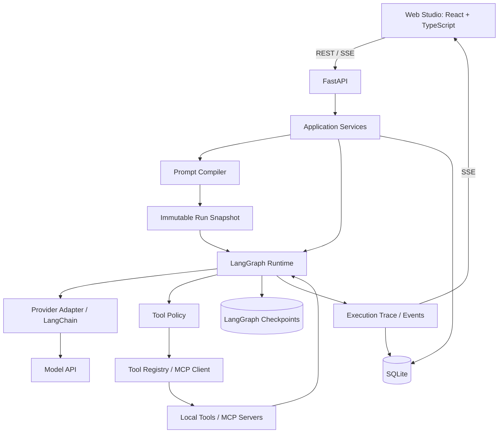

# Security Agent Studio

## Project Status

As of 2026-10-02, the project is in the architecture design phase. Neither the backend nor the Web UI has been implemented.
The Features section describes planned capabilities, not delivered functionality. Installation commands are not yet available.

The first release will include a **working Web UI, a Prompt Compiler, a single-agent tool loop, and execution tracing**.

- [Architecture and Detailed Design](docs/architecture.md): module boundaries, data models, APIs, UI design, and the implementation plan.
- [Development Guidelines](AGENTS.md): implementation and verification rules for developers and coding agents.

## Description
A prompt-orchestrated AI agent platform built with LangChain, LangGraph, FastAPI, and MCP.

Security Agent Studio combines the prompt composition experience of tools such as SillyTavern with the tool-using capabilities of modern coding agents.

Instead of hiding all instructions inside a single system prompt, the project allows prompts to be composed from independently configurable message blocks with explicit roles, ordering, conditions, and provider-specific behavior.

The long-term goal is to provide a flexible environment for building and evaluating security-oriented AI agents for tasks such as reverse engineering, code analysis, CTF challenges, debugging, and other authorized security workflows.

## Features

### Prompt Composer

Prompts are built from independent blocks rather than one large system prompt.

Each block supports:
- system, user, or assistant role
- enable / disable
- explicit ordering
- reusable presets
- provider-specific activation
- model-specific activation
- conditional activation

Example:

```
☑ Base Identity          SYSTEM
☑ Security Rules         SYSTEM
☑ Assistant Anchor       ASSISTANT
☐ Claude Adapter         SYSTEM
☑ Reverse Engineering    SYSTEM
☐ Web Security           SYSTEM
☑ Task Context           USER
```

The final message sequence remains visible and inspectable before it is sent to the model.

### Tool and MCP Integration

Agents can dynamically load tools through MCP.

Planned integrations include:
- IDA Pro
- Ghidra
- Python
- shell
- filesystem
- browser
- security-oriented MCP servers

Tools can be grouped into reusable profiles.

Example:

```
reverse:
  - ida
  - python
  - shell

analysis:
  - python
  - filesystem

web:
  - browser
  - shell
```

This prevents every agent from receiving every available tool.

### Agent Runtime

The project uses LangGraph for stateful agent execution.

Initial architecture:

```
User
 │
 ▼
Prompt Compiler
 │
 ▼
LangGraph Agent
 │
 ├──── no tool call ────► Response
 │
 └──── tool call
          │
          ▼
        Tools
          │
          └────────────► Agent
```

The first version intentionally uses a simple tool loop instead of a complex multi-agent architecture.

Future versions may introduce:

```
Planner
   ↓
Router
   ↓
Executor
   ↓
Reviewer
   ↓
Finish / Continue
```

### Prompt Execution Trace

Every model call can expose the exact messages that were generated.

Example:

```
[0] SYSTEM
Base Identity

[1] SYSTEM
Reverse Engineering Rules

[2] ASSISTANT
Assistant Anchor

[3] USER
Analyze this executable.
```

Prompt contribution and token usage can also be inspected:

```
Base Identity          620 tokens
Reverse Rules         1230 tokens
Assistant Anchor        87 tokens
Conversation          4200 tokens
Tool Schemas          7300 tokens
--------------------------------
Total                13437 tokens
```

This makes prompt behavior easier to debug than systems where the final model context is hidden.

### Prompt Evaluation

Security Agent Studio is designed to eventually support reproducible prompt experiments.

For example:

```
Preset A
vs
Preset B
```

can be evaluated against the same task set.

Possible metrics include:

- task success rate
- correctness
- refusal rate
- format compliance
- tool-call success rate
- tool-selection accuracy
- number of agent steps
- token usage
- latency
- API cost

Prompt ablation experiments can also measure the effect of individual blocks:

```
Full preset

Full - Identity
Full - Assistant Anchor
Full - Reverse Rules
Full - Output Rules

Identity only
Identity + Anchor
Identity + Reverse Rules
```

This helps determine which prompt components actually improve performance.

## Tech Stack

The following stack is planned. Exact dependency versions will be verified and recorded in lockfiles during project initialization.

Frontend (included in the first release):
- React + TypeScript + Vite
- TanStack Query for server state
- REST + Server-Sent Events (SSE)
- Vitest + Testing Library + Playwright

Backend:
- Python 3.12+
- FastAPI
- LangChain
- LangGraph
- Pydantic v2

Tool integration:
- MCP
- LangChain tools

Storage:
- SQLite initially
- SQLAlchemy 2 + Alembic for application data and migrations
- Persistent LangGraph checkpointer for run state
- PostgreSQL may be added later

Development:
- uv
- pytest
- Ruff
- Black
- isort
- npm + ESLint + Prettier for the frontend

## First Release Scope

| Capability | First release | Later extensions |
| --- | --- | --- |
| Prompt Composer | Block editing, enable/disable, ordering, conditions, variables, and versioned presets | Advanced templates and experiment management |
| Prompt Preview | Canonical messages, provider transformations, source mapping, and budget estimates | Context compression and finer token attribution |
| Agent Runtime | A single agent, multi-turn conversations, tool loops, timeouts, cancellation, approval, and recovery | Planner / Router / Executor / Reviewer |
| Tool / MCP | Tool profiles, controlled file reads, MCP stdio, and Streamable HTTP | Specialized integrations such as IDA, Ghidra, and browsers |
| Execution Trace | Requests for every model call, tool results, usage, latency, and redacted exports | Cross-experiment statistics and cost trends |
| Web Studio | Composer, conversation workspace, inspector, settings, and restored history | Evaluation dashboards and team collaboration |
| Prompt Evaluation | Immutable snapshots and a design for evaluation data interfaces | A/B comparisons, ablation experiments, and batch scoring |

The first release targets a single local user and binds to a loopback address. Remote multi-user deployment and a general-purpose code execution sandbox are outside its scope.
Actual shell/Python execution and specialized security tools require separate integration acceptance; MCP connectivity alone does not establish support.

## Architecture Overview



The application is a modular monolith. Frontend and backend development run separately; FastAPI serves the built frontend in a release.
Prompt compilation and provider adaptation remain separate. Runs bind to configuration snapshots, so editing a preset does not change an active task.
See the [architecture design](docs/architecture.md) for data flows, error handling, and recovery semantics.

## Implementation Roadmap

All milestones are planned and remain incomplete. M0–M4 together form the first usable release.

| Milestone | Deliverables | Completion criteria |
| --- | --- | --- |
| M0 Foundation | Python/React projects, database migrations, API types, and offline mocks | The Web UI can reach the backend health endpoint; baseline checks pass |
| M1 Prompt workflow | Block and preset management, compiler, and preview UI | Configuration edited in the UI deterministically produces messages with source mappings |
| M2 Conversation workflow | Provider integration, a single agent, streaming events, and session persistence | The Web UI starts real model conversations and exposes each request |
| M3 Tool workflow | Tool profiles, MCP, execution policies, and approval/rejection | Tool results return to the model; permission and error paths can be verified |
| M4 Usability and recovery | Cancellation, reconnection, checkpoint recovery, trace export, and end-to-end tests | State remains reliable after refreshes and process restarts; side effects are not blindly retried |
| M5 Evaluation and extensions | A/B tests, ablation, specialized tools, PostgreSQL, and more | Each capability is delivered against its own requirements and acceptance evidence |

Implementation starts with M0. The design and development guidelines above define the target layout, proposed development commands, and acceptance criteria for each milestone.
