# Security Agent Studio

## Project Status

As of 2026-10-03, a local MVP is implemented: **a working Web UI, deterministic Prompt Compiler, single-agent tool loop, approval and recovery controls, and execution tracing**.
The offline model exercises the complete workflow without credentials. The OpenAI-compatible Chat Completions adapter is verified against a mocked HTTP boundary; a live account or self-hosted model has not been tested in this environment.

The Features section describes the broader product direction. Current capabilities and limits are listed below; specialized security tools and evaluation workflows remain future work.

- [Architecture and Detailed Design](docs/architecture.md): module boundaries, data models, APIs, UI design, and the implementation plan.
- [Development Guidelines](AGENTS.md): implementation and verification rules for developers and coding agents.

## Quickstart

Requirements: Python 3.12+, [uv](https://docs.astral.sh/uv/), and Node.js 22.12+ with npm. Run commands from the repository root. The lockfiles were validated on Windows with Python 3.12.11 and Node.js 26.4.0.

```powershell
uv sync --dev --locked
npm --prefix web ci
npm --prefix web run build
uv run rtagent
```

Open **http://127.0.0.1:8001** to enter the workspace directly. No login or access token is needed. Startup applies Alembic migrations and seeds an example preset. Run one server worker, bound to loopback.

Try the complete offline workflow:

1. Open **Prompt** to edit a message block, then enter `/read README.md` in **Task**. Conversations are listed in the left sidebar; the editor and inspector open only when needed.
2. Select **Save & preview** or **Preview**. Inspect roles, ordering, source mappings, activation decisions, and the prepared request.
3. Select **Run**. The simulated model calls the real, bounded file tool and incorporates its result.
4. Open **Inspector → Run trace** to inspect both model calls and the tool receipt. **Show original trace** is an explicit local view; **Export JSON** always produces a labeled, redacted copy.
5. Try `/echo hello` to approve or reject a tool. `/slow` exercises cancellation. Refreshing the browser reloads existing state without submitting another Run.

### Connect a model or MCP server

Optionally copy `.env.example` to `.env`. Set credentials in that file or the server environment; enter only their variable names in **Settings**.

For a real model, select **OpenAI-compatible**, set the base URL and model ID served by your endpoint, and save. Use `OPENAI_API_KEY` as the credential reference, or leave the reference blank for a keyless local server. The adapter uses streaming Chat Completions with tool calls and usage reporting; endpoints must support the prepared fields shown in the preview. Unsupported role rewrites are rejected rather than silently changing the prompt. No SDK retries or provider fallbacks run automatically.

For MCP, add a **stdio** executable and argument list, or a **Streamable HTTP** URL. Use **Save & discover**, choose each tool's permission, then **Save settings**. New tools default to **Disabled**. Child environment entries map `NAME=SERVER_VARIABLE`; they do not contain secret values. HTTP bearer authentication uses a separate environment reference. With the simulated model, `/tool NAME {"argument":"value"}` invokes an enabled tool by its namespaced catalog name, visible in the preview's tool schemas.

The file reader is limited to UTF-8 files of at most 64 KiB under `STUDIO_WORKSPACE_ROOT`. It excludes linked paths, common credential/runtime files, and dependency directories. It is a local convenience boundary, not an OS sandbox.

### Local data and recovery

- `var/app.db`: presets, settings, sessions, immutable Run snapshots, events, and call receipts.
- `var/checkpoints.db`: LangGraph checkpoints, keyed by Run ID.
Runtime files and `.env` are ignored by Git.

Changing settings affects new Runs. Existing Runs retain their snapshot. A pending approval survives a restart. Interrupted calls with uncertain outcomes require an explicit retry or a verified tool result in the Web UI; retries may repeat an external effect or model charge. Cancellation stops local work and retains uncertainty; it cannot roll back external effects. Only successful turns enter conversation history.

Use **Delete conversation** for an idle session to remove its Runs, traces, events, previews, and checkpoints. Raw data is stored locally without application-level encryption. Redaction masks common patterns and fields; review exports before sharing.

## Current Implementation and Limits

| Area | Implemented baseline | Deliberately deferred |
| --- | --- | --- |
| Composer | Embedded blocks, aggregate preset revisions, conditions/variables as JSON, ordering, duplication, deterministic preview | Shared block library, historical revision editor, drag-and-drop |
| Runtime | One LangGraph worker, bounded model/tool attempts, streaming, approval, cancellation, durable receipts, explicit recovery | Multiple workers, multi-agent orchestration, automatic retries |
| Providers | Offline simulation and OpenAI-compatible text/tool streaming with request capture | Other provider protocols, images, automatic capability negotiation |
| Tools | Controlled file reads, echo, stateless stdio/HTTP MCP with schema checks | Stateful MCP sessions, built-in shell/Python sandbox, IDA/Ghidra acceptance |
| Inspection | Per-call canonical/prepared/captured requests, results, actual usage when returned, export, session deletion | Replay imports, automatic retention jobs, side-by-side comparisons, cost catalog |

Presets own their blocks; settings own provider options, permissions, and MCP connections. Versions protect edits and immutable snapshots preserve execution evidence. Each backend responsibility is a small module, without generic repository or plugin abstractions. MCP opens a fresh session for each discovery/call, so a server that requires a long-lived analysis session needs a future adapter. The sidebar lists the 100 most recent sessions. Context estimates use a byte heuristic; unknown usage remains `null` and no automatic trimming occurs. Approvals remain pending until explicitly resolved or cancelled.

## Development and Verification

For live frontend development, run the backend command above and `npm --prefix web run dev` in another terminal. Open http://127.0.0.1:5173; Vite proxies `/api` to the backend. After changing API contracts, regenerate the committed TypeScript types:

```powershell
uv run python scripts/export_api.py
npm --prefix web run generate:api
```

Checks from the repository root:

```powershell
uv run pytest
uv run ruff check src tests scripts migrations
uv run black --check src tests scripts migrations
uv run isort --check-only src tests scripts migrations
npm --prefix web run lint
npm --prefix web run typecheck
npm --prefix web run test -- --run
npm --prefix web run format:check
npm --prefix web run build
```

Browser tests start their own loopback backend with temporary data under `var/`. Build the frontend first, then:

```powershell
Set-Location web
npx playwright install chromium
npm run test:e2e
```

Default Python tests use temporary SQLite databases, HTTP mocks, and local stdio/HTTP MCP fixtures. Browser tests cover editing, request inspection, tool approval/rejection, cancellation, refresh, settings, MCP execution, and narrow layouts. These checks do not call paid or external model services.

## Description
A prompt-orchestrated AI agent platform built with LangChain, LangGraph, FastAPI, and MCP.

Security Agent Studio combines the prompt composition experience of tools such as SillyTavern with the tool-using capabilities of modern coding agents.

Instead of hiding all instructions inside a single system prompt, the project allows prompts to be composed from independently configurable message blocks with explicit roles, ordering, conditions, and provider-specific behavior.

The long-term goal is to provide a flexible environment for building and evaluating security-oriented AI agents for tasks such as reverse engineering, code analysis, CTF challenges, debugging, and other authorized security workflows.

## Features

### Prompt Composer

Prompts are built from independent blocks rather than one large system prompt.

Each block supports:
- system, user, or assistant role
- enable / disable
- explicit ordering
- reusable presets
- provider-specific activation
- model-specific activation
- conditional activation

Example:

```
☑ Base Identity          SYSTEM
☑ Security Rules         SYSTEM
☑ Assistant Anchor       ASSISTANT
☐ Claude Adapter         SYSTEM
☑ Reverse Engineering    SYSTEM
☐ Web Security           SYSTEM
☑ Task Context           USER
```

The final message sequence remains visible and inspectable before it is sent to the model.

### Tool and MCP Integration

Agents can dynamically load tools through MCP.

Planned integrations include:
- IDA Pro
- Ghidra
- Python
- shell
- filesystem
- browser
- security-oriented MCP servers

Tools can be grouped into reusable profiles.

Example:

```
reverse:
  - ida
  - python
  - shell

analysis:
  - python
  - filesystem

web:
  - browser
  - shell
```

This prevents every agent from receiving every available tool.

### Agent Runtime

The project uses LangGraph for stateful agent execution.

Initial architecture:

```
User
 │
 ▼
Prompt Compiler
 │
 ▼
LangGraph Agent
 │
 ├──── no tool call ────► Response
 │
 └──── tool call
          │
          ▼
        Tools
          │
          └────────────► Agent
```

The first version intentionally uses a simple tool loop instead of a complex multi-agent architecture.

Future versions may introduce:

```
Planner
   ↓
Router
   ↓
Executor
   ↓
Reviewer
   ↓
Finish / Continue
```

### Prompt Execution Trace

Every model call can expose the exact messages that were generated.

Example:

```
[0] SYSTEM
Base Identity

[1] SYSTEM
Reverse Engineering Rules

[2] ASSISTANT
Assistant Anchor

[3] USER
Analyze this executable.
```

Prompt contribution and token usage can also be inspected:

```
Base Identity          620 tokens
Reverse Rules         1230 tokens
Assistant Anchor        87 tokens
Conversation          4200 tokens
Tool Schemas          7300 tokens
--------------------------------
Total                13437 tokens
```

This makes prompt behavior easier to debug than systems where the final model context is hidden.

### Prompt Evaluation

Security Agent Studio is designed to eventually support reproducible prompt experiments.

For example:

```
Preset A
vs
Preset B
```

can be evaluated against the same task set.

Possible metrics include:

- task success rate
- correctness
- refusal rate
- format compliance
- tool-call success rate
- tool-selection accuracy
- number of agent steps
- token usage
- latency
- API cost

Prompt ablation experiments can also measure the effect of individual blocks:

```
Full preset

Full - Identity
Full - Assistant Anchor
Full - Reverse Rules
Full - Output Rules

Identity only
Identity + Anchor
Identity + Reverse Rules
```

This helps determine which prompt components actually improve performance.

## Tech Stack

The following stack is planned. Exact dependency versions will be verified and recorded in lockfiles during project initialization.

Frontend (included in the first release):
- React + TypeScript + Vite
- TanStack Query for server state
- REST + Server-Sent Events (SSE)
- Vitest + Testing Library + Playwright

Backend:
- Python 3.12+
- FastAPI
- LangChain
- LangGraph
- Pydantic v2

Tool integration:
- MCP
- LangChain tools

Storage:
- SQLite initially
- SQLAlchemy 2 + Alembic for application data and migrations
- Persistent LangGraph checkpointer for run state
- PostgreSQL may be added later

Development:
- uv
- pytest
- Ruff
- Black
- isort
- npm + ESLint + Prettier for the frontend

## First Release Scope

| Capability | First release | Later extensions |
| --- | --- | --- |
| Prompt Composer | Block editing, enable/disable, ordering, conditions, variables, and versioned presets | Advanced templates and experiment management |
| Prompt Preview | Canonical messages, provider transformations, source mapping, and budget estimates | Context compression and finer token attribution |
| Agent Runtime | A single agent, multi-turn conversations, tool loops, timeouts, cancellation, approval, and recovery | Planner / Router / Executor / Reviewer |
| Tool / MCP | Tool profiles, controlled file reads, MCP stdio, and Streamable HTTP | Specialized integrations such as IDA, Ghidra, and browsers |
| Execution Trace | Requests for every model call, tool results, usage, latency, and redacted exports | Cross-experiment statistics and cost trends |
| Web Studio | Composer, conversation workspace, inspector, settings, and restored history | Evaluation dashboards and team collaboration |
| Prompt Evaluation | Immutable snapshots and a design for evaluation data interfaces | A/B comparisons, ablation experiments, and batch scoring |

The first release targets a single local user and binds to a loopback address. Remote multi-user deployment and a general-purpose code execution sandbox are outside its scope.
Actual shell/Python execution and specialized security tools require separate integration acceptance; MCP connectivity alone does not establish support.

## Architecture Overview

```mermaid
flowchart TD
    UI[Web Studio: React + TypeScript] -->|REST / SSE| API[FastAPI]
    API --> APP[Application Services]
    APP --> COMP[Prompt Compiler]
    APP --> RUN[LangGraph Runtime]
    COMP --> SNAP[Immutable Run Snapshot]
    SNAP --> RUN
    RUN --> PROVIDER[Provider Adapter / LangChain]
    PROVIDER --> MODEL[Model API]
    RUN --> POLICY[Tool Policy]
    POLICY --> TOOLS[Tool Registry / MCP Client]
    TOOLS --> TARGET[Local Tools / MCP Servers]
    TARGET --> RUN
    APP --> DB[(SQLite)]
    RUN --> CHECKPOINT[(LangGraph Checkpoints)]
    RUN --> TRACE[Execution Trace / Events]
    TRACE --> DB
    TRACE -->|SSE| UI
```



The application is a modular monolith. Frontend and backend development run separately; FastAPI serves the built frontend in a release.
Prompt compilation and provider adaptation remain separate. Runs bind to configuration snapshots, so editing a preset does not change an active task.
See the [architecture design](docs/architecture.md) for data flows, error handling, and recovery semantics.

## Implementation Roadmap

The local baseline covers the core workflows in M0–M4. The detailed design also contains deferred capabilities listed above; this is not a claim that every design proposal has shipped. Live model acceptance remains pending user endpoint configuration.

| Milestone | Deliverables | Completion criteria |
| --- | --- | --- |
| M0 Foundation | Python/React projects, database migrations, API types, and offline mocks | The Web UI can reach the backend health endpoint; baseline checks pass |
| M1 Prompt workflow | Block and preset management, compiler, and preview UI | Configuration edited in the UI deterministically produces messages with source mappings |
| M2 Conversation workflow | Provider integration, a single agent, streaming events, and session persistence | The Web UI starts real model conversations and exposes each request |
| M3 Tool workflow | Tool profiles, MCP, execution policies, and approval/rejection | Tool results return to the model; permission and error paths can be verified |
| M4 Usability and recovery | Cancellation, reconnection, checkpoint recovery, trace export, and end-to-end tests | State remains reliable after refreshes and process restarts; side effects are not blindly retried |
| M5 Evaluation and extensions | A/B tests, ablation, specialized tools, PostgreSQL, and more | Each capability is delivered against its own requirements and acceptance evidence |

M5 remains future work. Extend the current vertical workflow only when a concrete use case requires it.
