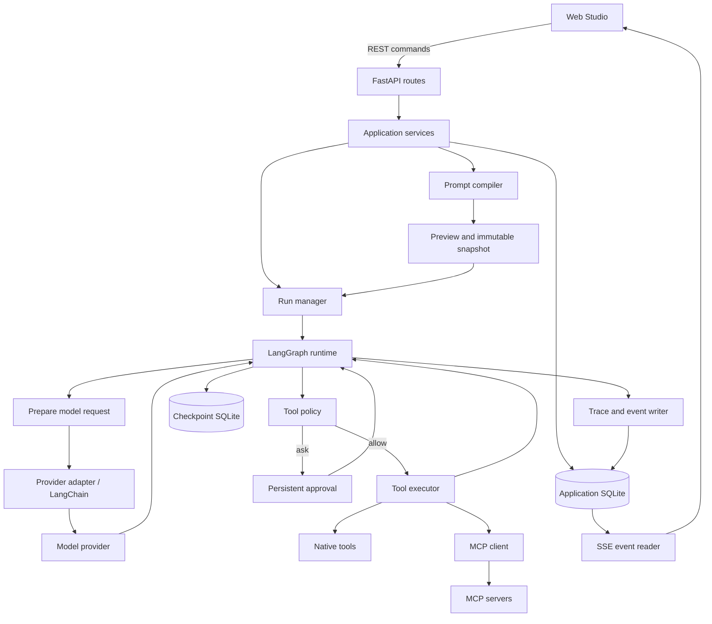
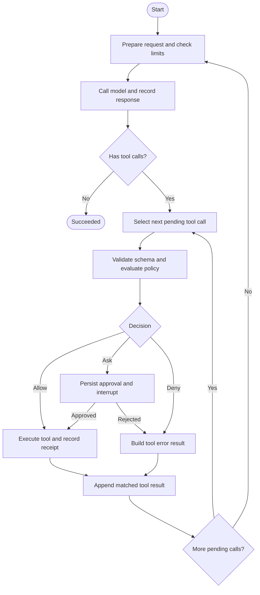

# Security Agent Studio: Architecture and Detailed Design

Status: design proposal; not implemented. Last updated: 2026-10-02.

This document expands the product goals in the [README](../README.md) into implementable modules, data flows, interfaces, and acceptance criteria.
The first release must include a working Web UI, as confirmed by the user. Other additions are design recommendations; dependency versions will be verified and pinned during project initialization.
At the time of writing, the repository contains only documentation. All directories, tables, interfaces, and commands below describe the target design.

## 1. Product Scope and First Release Experience

The central product concept is an agent execution configuration that can be inspected, reused, and compared.
A complete user workflow is:

1. Configure a model connection and select or create a prompt preset and tool profile.
2. Edit message block roles, placements, ordering, enabled states, conditions, and variables.
3. Enter a task and inspect the final messages, provider transformations, available tools, and context budget.
4. Start a Run, read streaming responses in the Web UI, inspect tool calls, and handle calls that require confirmation under the configured policy.
5. Inspect every model request, its tool results, usage, and latency; continue the conversation or export a redacted record.
6. Refresh the UI without losing execution status. After a process failure, distinguish recoverable steps from calls with unknown outcomes.

The first release targets a single local user, text messages, and low concurrency. It can read analysis samples from user-selected directories; binary or multimodal uploads and large-scale artifact management are not included.
A fake model can support the entire UI workflow before at least one real model provider is integrated.

Outside the first release: multi-agent orchestration, batch A/B or ablation runners, multi-tenancy, public remote deployment, vector retrieval, a general-purpose code sandbox, and complete specialized integrations such as IDA, Ghidra, or browsers.
Python and shell execution are optional capabilities for later tool profiles. Running locally does not replace execution isolation.

## 2. Architecture Decisions

| Decision | Choice | Rationale and boundaries |
| --- | --- | --- |
| Deployment | Modular monolith; one API/Runner process in the first release | Straightforward local development without a distributed queue or cross-service transactions |
| Web | React + TypeScript + Vite | Supports editing, streaming conversations, and inspection panels; SSR is unnecessary |
| Web state | TanStack Query plus component-local editing state | Centralized server-state caching without another global state framework in the first release |
| HTTP | FastAPI + Pydantic v2 | API validation, OpenAPI, and frontend type contracts |
| Orchestration | Explicit LangGraph StateGraph | A simple tool loop with control over nodes, checkpoints, and interrupts |
| Model adaptation | LangChain integrations wrapped in ProviderAdapter | Keep framework types and provider differences out of the domain layer |
| Tools | Unified registry; native tools and MCP share an execution entry point | Tool profiles and policies constrain both sources |
| Application data | SQLite + SQLAlchemy 2 + Alembic | Simple local deployment; repository boundaries allow later PostgreSQL migration |
| Execution state | Persistent LangGraph checkpointer | Handles interrupt recovery separately from application tables; not the application query database |
| Push updates | REST commands plus SSE events | Commands and subscriptions are separate; events can be replayed without requiring WebSocket |
| Evaluation preparation | Immutable snapshots, a call ledger, and versioned traces | Preserve evidence before implementing an experiment runner |

The README's choices of Python 3.12+, LangChain, LangGraph, FastAPI, Pydantic v2, MCP, SQLite, and uv remain in place.
Ruff handles linting, Black handles formatting, and isort handles import sorting, avoiding repeated rewrites by overlapping tools.

## 3. System Structure and Responsibilities



| Module | Main responsibilities | Excluded responsibilities |
| --- | --- | --- |
| `domain` | Contracts for blocks, presets, Runs, messages, tool calls, events, and errors | HTTP, SQL, and SDK calls |
| `prompts` | Condition evaluation, variable substitution, deterministic ordering, message assembly, and source mapping | Reading data, calling models, or executing tools |
| `application` | Creating previews, freezing snapshots, starting/stopping/resuming Runs, and configuration versioning | Provider serialization details |
| `providers` | Model capabilities, tool binding, message mapping, outbound requests, and usage normalization | Writing conversations or deciding tool permissions |
| `runtime` | Graph state, nodes, stop conditions, interrupts, and recovery | HTTP request lifecycles |
| `tools` | Tool discovery, schemas, MCP connections, execution, and result normalization | Choosing tools for the model or expanding permissions |
| `policies` | Tool/resource scope, parameter constraints, and allow/deny/ask decisions | Treating natural-language content as new authorization |
| `tracing` | Call evidence, events, redacted views, metering, and exports | Copying full conversations into ordinary logs |
| `storage` | Repositories, application migrations, transactions, and queries | Directly modifying LangGraph's internal state format |
| `api` / `web` | User interaction, protocol conversion, and state presentation | Duplicating compilation and permission rules |

Dependencies point inward: domain models and pure compilation logic do not depend on infrastructure. Application defines the Repository, Provider, ToolExecutor, and other interfaces its use cases require; the entry point wires their implementations together.
Do not create a Service/Manager/Factory for every data class merely to enforce a formal layer structure.

## 4. Core Objects and Versioning

| Object | Key fields | Invariants |
| --- | --- | --- |
| `PromptBlockRevision` | `block_id, revision, name, role, template, variables, provider_allowlist, model_allowlist, condition` | Immutable content version; role is one of the three configurable roles |
| `PresetRevision` | `preset_id, revision, name, entries, schema_version` | Saving creates a new version; existing Runs retain their snapshots |
| `PresetEntry` | `entry_id, block_id, block_revision, enabled, placement, order` | Order is unique within each placement of a preset |
| `ProviderConfig` | `id, revision, adapter, model, base_url, credential_ref, parameters` | No stored API key; model capabilities are versioned separately |
| `ToolDefinition` | `qualified_name, server_ref, original_name, input_schema, schema_hash` | Exposed names are unique and mappings are reversible |
| `ToolProfileRevision` | `id, revision, tools, policy, limits` | Explicit tool list; new server tools do not expand it automatically |
| `Session` | `id, title, committed_revision, active_run_id` | At most one nonterminal Run per session |
| `PreviewSnapshot` | `id, input_hash, session_revision, resolved_config, compiled_prompt, expires_at` | Freezes the first request's inputs; invokes neither models nor tools |
| `RunSnapshot` | `id, preset, blocks, model_config, capabilities, tools, policy, limits, history, current_input, variables, versions` | Stores resolved content, not just mutable references |
| `Run` | `id, session_id, snapshot_id, status, stop_reason, usage, timestamps` | One Run per user submission |
| `ModelCall` | `id, run_id, step, request, response, usage, latency, attempt` | Each round and retry can be distinguished |
| `ToolCall` | `id, model_call_id, tool_call_id, args_hash, status, result_ref` | Model tool call IDs map one-to-one to local execution records |
| `Approval` | `id, run_id, tool_call_id, args_hash, policy_revision, decision, expires_at` | Valid only for this call and these arguments |
| `RunEvent` | `run_id, seq, type, timestamp, payload, schema_version` | `(run_id, seq)` is unique and monotonically increasing |

IDs do not depend on display names. Store time in UTC and display it in the user's local timezone.
Edits include `expected_revision`; return 409 on conflicts to prevent silent overwrites between browser tabs.
When a block is referenced more than once, use distinct `entry_id` values to identify its placement and estimated token contribution.

## 5. Prompt Compiler

### 5.1 Composition Model

The first release provides two explicit block insertion points:

```text
Enabled before_history blocks (ascending order)
Complete committed conversation history
Enabled before_input blocks (ascending order)
Current user input (exactly once)
Assistant/tool message delta for this Run
```

System, user, and assistant blocks can be ordered freely within an insertion point. Report role combinations unsupported by the provider explicitly.
To preserve call/result pairing, the first release does not support inserting blocks between a tool call and its result or after the Run's message delta.
`before_history` suits identity and rules; `before_input` suits current task context or examples. Provider capabilities determine role restrictions.
The UI displays both insertion points and read-only placeholders for history and user input, so block order is not mistaken for the complete message sequence.

Conditions use restricted JSON expressions: composite nodes are `all / any / not`; leaves use `field / op / value`; supported operators are only `eq / in / exists`.
Fields can reference only the provider, model, task_type, variables, and available tool names explicitly declared in the compilation context. They cannot execute arbitrary code.
A node cannot combine leaf and composite forms. A missing field evaluates to false for `exists` and is an error for other operators.
An empty `all` is true; an empty `any` is false. A model/provider allowlist of `null` means unrestricted; an empty list matches nothing.

Variables initially support only literal `{{name}}` substitution. They must be declared with explicit types, and substituted values are not interpreted as templates again.
Method calls, attribute traversal, file reads, and shell expansion are prohibited. Blocks may use `task_context`; the current user input is inserted through a dedicated slot and is not exposed as a template variable.

### 5.2 Compilation Steps

1. Application loads configuration and the session, resolves versions, and prepares tool schemas, capabilities, and the variable context.
2. Compiler validates schemas, references, roles, placement, order, and variable declarations.
3. Filter entries by enabled state, provider, model, and condition, recording why each entry was included or excluded.
4. Substitute variables, sort entries, and assemble canonical messages using the slots above. Map entries, history, and tool results to messages and content ranges.
5. ProviderAdapter constructs the request according to declared capabilities and records required transformations and capability errors.
6. Estimate the context budget, reserve an output budget, and generate compilation diagnostics and the input hash.
7. Application stores the preview snapshot and returns it to the UI. This process invokes neither models nor tools; the required tool catalog must already have been refreshed.

`compile_prompt(snapshot, conversation, run_delta) -> CompiledPrompt` is a pure computation interface with no I/O.
Template parsing, condition evaluation, and logical message assembly belong to Compiler. Provider-specific representation changes are an adjacent, separate layer.

The output includes at least `messages`, `source_map`, `activation_report`, `diagnostics`, `token_estimate`, and `input_hash`.
The hash covers normalized input, history revision, compiler version, adapter version, tool schemas, generation parameters, and context policy. It excludes request timestamps and random request IDs.

### 5.3 Example

Configuration:

| entry | placement | order | role | Content/condition |
| --- | --- | --- | --- | --- |
| identity | before_history | 10 | system | Base platform identity |
| reverse_rules | before_history | 20 | system | `task_type == reverse` |
| anchor | before_input | 10 | assistant | An example response format |
| context | before_input | 20 | user | `Task context: {{task_context}}` |

For an initial conversation where the condition matches, the logical messages are:

```text
[0] system     identity
[1] system     reverse_rules
[2] assistant  anchor
[3] user       context
[4] user       Current input: Analyze the target function's control flow
```

This request is not valid for every model. If the provider rejects this sequence, the preview must show a specific capability error so the user can adjust the preset.
If a provider requires consecutive system messages to be placed in a top-level field, the preview shows the original and transformed representations with source ranges, rather than implying an unchanged transmission.

### 5.4 Budgets and Consistency

In the first release, context overflow returns `context_budget_exceeded` with estimates for messages, tool schemas, and reserved output.
Do not silently remove earlier history, prompt blocks, or tool results. Future trimming must operate on complete tool rounds and show what was removed.
Per-block token counts are attribution estimates and may not add up to the provider's actual input tokens. Keep them separate in both data fields and the UI.
If the context window is unknown or no usable counter is available, display Unverified rather than a passed budget check. Explicit Run step and output limits still apply.

When the user starts a Run, submit `preview_id + input_hash + expected_session_revision`.
After verifying that configuration and session versions are unchanged, the backend copies the snapshot, creates the Run, reserves the session, and records the first event in one application transaction.
Configuration or input changes invalidate the preview; return 409 and require a new preview. Retries of the same submission return the same Run through the idempotency key.
The first call uses the same prepared request as the preview. Later rounds append the Run's messages, compile independently, and record a trace before sending.
The preview represents the first request. Subsequent automatic tool-loop requests must not be labeled as individually confirmed by the user.

## 6. Provider Adapter and Final Requests

Interface boundaries:

```text
capabilities(model) -> ModelCapabilities
prepare(compiled_prompt, tool_schemas, parameters) -> PreparedRequest
stream(prepared_request) -> normalized model events
normalize_response(response) -> AssistantMessage + Usage + StopReason
```

Capabilities cover system message placement/representation, consecutive messages with the same role, assistant examples or prefixes, tool calling, tool name/schema restrictions, streaming, context windows, and parameter constraints.
Do not assume support when a capability is unknown. Record the capability description and adapter version in RunSnapshot.
Conditional activation by provider/model is separate from protocol adaptation. A Claude Adapter prompt block cannot replace API compatibility.

LangChain handles integration, but `bind_tools`, message conversion, and SDK parameter additions must remain observable inside the adapter.
Traces retain all of the following:

- `canonical_messages`: compiler messages and their sources.
- `prepared_request`: the request body prepared for the target provider.
- `wire_request_body`: the actual application-level request body captured at the HTTP transport boundary, excluding authentication headers.
- `transformations`: merges, field extraction, defaults, tool name mappings, and other changes.

If the SDK still rewrites a request before sending, capture and validate it at the transport boundary. An adapter without a verifiable capture path cannot claim complete request tracing.
Deterministic fields shown in the preview must match the first outbound request. Dynamic non-prompt metadata, such as request IDs, may differ, but differences must be labeled.
Prompts and hidden state added inside the model service are outside the visible boundary.

Tool results pair with requests through the original `tool_call_id`, consistent with LangChain's [ToolMessage contract](https://reference.langchain.com/python/langchain-core/messages/tool/ToolMessage).
When a model returns multiple tool calls, execute them sequentially in the first release, then submit the complete result group. Do not execute tools until streaming arguments are complete and pass schema validation.
Transient model network errors may receive bounded retries, with each attempt accounted for separately. If output has already streamed, mark the previous attempt invalid; never concatenate responses from separate attempts.

## 7. LangGraph Runtime and Run Lifecycle

### 7.1 Execution Graph



Any node may terminate because of cancellation, a budget limit, a protocol error, or an unrecoverable exception. Those terminal paths are omitted from the diagram for readability.
Use an explicit StateGraph; do not invoke another built-in agent to manage the same loop.

The minimum `AgentState` contains:

```text
run_id, snapshot_id, current_step
run_messages                  # Assistant/tool delta for this Run
pending_tool_calls, next_tool_index
model_call_id, approval_id
usage_so_far, limits, cancel_requested
error, stop_reason
```

Read the current user input, variables, committed history, and static prompt blocks from the immutable RunSnapshot.
Do not append those inputs repeatedly during assembly. The graph accumulates only model and tool messages produced by the current Run.
State messages have stable IDs; reentered nodes deduplicate through call records.

### 7.2 States and Stop Conditions

| State | Entry condition | Next states |
| --- | --- | --- |
| `queued` | Created successfully; waiting for the Runner | running / cancelled |
| `running` | Calling the model or processing tools | waiting_approval / cancelling / interrupted / succeeded / failed |
| `waiting_approval` | A pending approval is persisted and the graph is interrupted | running / cancelled / failed (approval expired) |
| `cancelling` | Stop request accepted; waiting for local execution to exit or its state to be confirmed | cancelled / interrupted |
| `interrupted` | Process failure, unknown execution outcome, or manual recovery required | running / cancelled / failed |
| `succeeded` | Final model response completed with no pending tools | Terminal |
| `failed` | Limit exceeded, unrecoverable error, or invalid protocol | Terminal |
| `cancelled` | Execution stopped; no further calls will be scheduled | Terminal |

`stop_reason` is separate from state; examples include `completed`, `max_steps`, `timeout`, `provider_error`, `tool_schema_changed`, and `cancelled_by_user`.
Tool execution failures normally become error ToolMessages with their original IDs, allowing the model to correct its approach. Protocol errors such as missing tool IDs or invalid responses cannot be bypassed with fabricated results.
Rejected calls return `tool_denied`. Each renewed request consumes step/tool budget, preventing an unbounded approval loop.

Proposed initial defaults are at most 20 model calls, 40 tool calls, 60 seconds per tool, and 10 minutes of active execution. Run configuration may tighten these limits.
These are initial configuration recommendations, not measured performance results. Approval wait time does not count toward active execution time, but approvals expire independently.
Model retries consume call budget; tool rejections, argument errors, and retries all count as tool attempts.
Also limit output tokens per call, tool output bytes, and queue length. Unknown prices prevent a promise of precise monetary budget enforcement.

### 7.3 Execution and Session Isolation

The API returns 202 after creating a Run. A managed in-process Runner claims work from persisted `queued` records.
Default to one active Run with configurable bounded concurrency, and use only one Uvicorn worker in the first release.
The sole reference to a long-running task must not live in an HTTP request, an SSE generator, or one-off `BackgroundTasks`.
The API lifespan starts and closes the Runner, database connections, and MCP clients using FastAPI's [lifespan mechanism](https://fastapi.tiangolo.com/advanced/events/).

Queued, running, awaiting-approval, and interrupted Runs all occupy a Session's `active_run_id`; another submission to that session returns 409.
Different sessions have separate execution state. Server-side transactional checks and Runner claiming together prevent duplicate execution.
A browser SSE disconnect ends only the subscription; the Run continues. Clicking Stop sends the cancellation command.
Cancellation makes a best effort to stop external calls but does not undo file changes or remote side effects already produced.

On success, commit the current input plus the complete assistant/tool delta as one conversation turn and increment `committed_revision`.
Keep failed, cancelled, or unconfirmed partial traces in their Runs without automatically including them in later model history. Label them Not included in context in the UI.
Commit the conversation turn, terminal state, and terminal event in one application database transaction, deduplicated by Run ID.
Every terminal state releases the Session's `active_run_id` in that same transaction. Failure and cancellation do not increment the committed history revision.

### 7.4 Checkpoints and Recovery

Set `thread_id = run_id`. Each user submission creates a new graph thread; the application supplies committed history for conversation continuity.
A new Run after a preset edit therefore does not inherit hidden system messages or graph state from the preceding Run.
Resuming a Run uses its original `run_id`, checkpoint, and snapshot.
Recovery requires a persistent checkpointer. In-memory savers are for unit tests only; see LangGraph's [persistence documentation](https://docs.langchain.com/oss/python/langgraph/persistence).

An approval node only prepares confirmation information and interrupts. After approval, execution enters a separate tool node.
Resuming an interrupt may restart the node from its beginning, so pre-interrupt logic must be reentrant; see [LangGraph interrupts](https://docs.langchain.com/oss/python/langgraph/interrupts).

The tool ledger identifies calls uniquely by `(run_id, model_call_id, tool_call_id)` and records `pending / executing / succeeded / failed / outcome_unknown`.
Persist intent before execution, then persist the result before updating graph state. Reentered nodes reuse completed call results.
The application and checkpoint databases do not share a transaction. Startup and recovery must reconcile state against the ledger rather than assume both writes always succeed together.
Model calls also record request attempts and completion receipts. If a response was persisted before the checkpoint, reuse it rather than paying for another call.

If the process exits after an external side effect but before its result is persisted, mark the call `outcome_unknown`:

- When the external server supports idempotency keys or result queries, the adapter may confirm the outcome from that evidence.
- Calls confirmed to be read-only and retryable may be retried during recovery.
- Never automatically replay writes or arbitrary code execution. Show the target and arguments, and let the user verify the outcome before choosing Record completed result, Explicitly retry, or Terminate.

There is no exactly-once guarantee across arbitrary external tools. Losing a model response during a crash window can also cause another charge; record uncertain attempts and disclose them during recovery.
At startup, change leftover `running/cancelling` Runs to `interrupted`. Runs in `queued` may be claimed again; existing `waiting_approval` Runs continue waiting.
The first release does not automatically rerun interrupted Runs. Users initiate resumption from the recovery panel.

## 8. Tool Registry, Profiles, and MCP

### 8.1 Unified Tool Entry Point

Native and MCP tools both become `ToolDefinition` objects. The model sees only the tool list frozen for its Run.
Names combine a server alias and the original tool name, then use adapter-specific encoding accepted by the target model. Resolve collisions with a stable short hash and retain the mapping in the snapshot.
Profiles bind explicit tools and schema versions, not just entire servers. New server tools do not automatically enter existing profiles.

Execution order: find the snapshot tool → validate JSON Schema → validate resources and arguments → decide allow/deny/ask → record intent → execute → normalize and bound the result → record receipt.
Use distinct error codes for missing tools, invalid arguments, denied permissions, timeouts, and connection failures.
If a discovered tool schema differs from the snapshot, stop using that definition and return `tool_schema_changed`. Accept the change only after rediscovery and a new Run.

### 8.2 Policy

Effective permission is the intersection of the profile's tool set, the user's selected workspace/target scope, and server-side policy. Prompts cannot override it.
The first-release default allows explicitly configured read-only calls, asks for writes, code execution, or unknown capabilities, and denies out-of-scope calls.
MCP read-only or destructive annotations are display hints; local configuration determines the decision.
Approval binds the exact argument hash, tool version, and Run. A previous approval for the same tool name does not authorize a new call with different arguments.
Rejected or expired approvals cannot be reused. Repeating the same decision is idempotent; conflicting decisions return 409.

Native file tools check that the resolved absolute path lies within an authorized root and handle symlinks, Windows junctions, size limits, and encoding constraints.
Path authorization alone is not an OS sandbox. If another process can replace the target concurrently, use handle-level validation or a separate isolated process.
First-release acceptance uses a read-only text tool inside a controlled workspace and test MCP tools. It does not deliver unrestricted shell/Python executors.

### 8.3 MCP Lifecycle and Transports

Server configuration explicitly defines executable/args/cwd/environment references for stdio or URL/authentication references for remote connections. It must not accept model-generated launch commands.
Start child processes with argument arrays and a minimal environment; inject credentials separately for each server.
Do not pass other providers' secrets to an arbitrary MCP server by inheriting the entire parent environment.

A connection manager handles MCP session creation, handshakes, discovery, health, timeouts, closure, and necessary reconnection.
Shared stateless servers can reuse connections. Servers holding mutable analysis state, such as an IDA project, must declare session isolation or be accessed serially per server.
On application exit, close sessions and reclaim local child processes. Treat stderr as controlled diagnostics; it must not mix with protocol stdout.

Support stdio and Streamable HTTP through the official SDK, recording negotiated versions in connection metadata and traces.
Transport terminology follows [MCP 2025-11-25 Transports](https://modelcontextprotocol.io/specification/2025-11-25/basic/transports); this is not a claim about the latest version.
Pin and contract-test the selected SDK/protocol versions in M0/M3. Do not assume compatibility during protocol upgrades.
Add legacy HTTP+SSE compatibility only for a specific integration need, and distinguish it from this application's browser SSE event API.
MCP cancellation follows the negotiated protocol version. A browser disconnect from Studio must not be forwarded as MCP cancellation.

## 9. Storage, Tracing, and Data Boundaries

### 9.1 Storage Layout

```text
var/                       # Local runtime data; excluded from version control
  app.db                   # Application tables, messages, call ledger, events
  checkpoints.db           # Persistent LangGraph checkpoints
  artifacts/               # Size-limited large tool results and trace content
```

Application table groups:

- Configuration: `prompt_blocks / prompt_block_revisions / presets / preset_revisions / provider_configs / mcp_servers / tool_profiles / tool_profile_revisions`.
- Conversations and execution: `sessions / conversation_turns / conversation_messages / preview_snapshots / run_snapshots / runs`.
- Evidence and interaction: `model_calls / tool_calls / approvals / run_events / artifacts`.
- Local access: `browser_sessions`, storing only session credential hashes and expiration information.

Block and preset content may use versioned JSON to retain complete structures. Use explicit columns for Run foreign keys, state, timestamps, and query indexes.
Enable foreign keys, WAL, and a bounded busy timeout. Do not hold database write transactions during model or tool network calls.
Add unique constraints for revisions, session reservations, idempotency keys, tool call keys, and event sequence numbers.
Alembic manages the application schema; the selected checkpointer manages its own schema. Back up the complete data set while stopped or with coordinated snapshots. Independent copies of two actively written files do not establish a consistent recovery point.

### 9.2 Tracing and Metering

For each model call, record inputs, capabilities/transformations, response, stop reason, attempt number, latency, and provider request ID.
For each tool call, record its source, arguments, permission decision, start/end times, result summary, and full artifact reference.
The frontend lets users switch between model calls within one Run and inspect how tool results entered the next prompt.

Label three categories separately:

| Data | Source | Usage |
| --- | --- | --- |
| Estimated tokens | Compiler/adapter counters | Preview and block contribution analysis; record counter versions |
| Actual usage | Provider response | Original input/output/cache fields and normalized fields |
| Estimated cost | Usage plus versioned price configuration | Null when prices or usage are missing; never presented as the actual bill |

Aggregate Run usage across all call attempts. Tool error rate, step count, and latency can be calculated from call records.
Unknown usage, interrupted streams, and requests with uncertain billing must carry an Incomplete marker. Do not hide missing information with zero.
For oversized tool content, store a bounded artifact or explicitly reject it. Mark truncated text sent to the model and record the exact contextual version in the trace.

### 9.3 Local Access and Sensitive Information

Bind to `127.0.0.1` and validate Host/Origin in the first release. The Web UI exchanges a local access token for an HttpOnly, SameSite session cookie.
The unlock endpoint validates Host/Origin; authenticated session writes validate both Origin and a CSRF token.
Local configuration supplies the access token. Do not transmit it in URLs or store model API keys in browser localStorage.
Vite proxies `/api` during development; releases serve frontend assets from the same origin. Remote deployment needs a separate design for authentication, HTTPS, user isolation, and execution environments; changing the bind address to `0.0.0.0` is insufficient.

Provider/MCP authentication uses server-side `credential_ref` values resolved only at connection boundaries. Never write secret values into prompts, application snapshots, or trace authentication headers.
User inputs and tool results may themselves contain sensitive samples. Keep exact traces in the runtime data directory protected by local access controls, outside ordinary logs and default telemetry.
The UI offers redacted views and exports by default; locally authenticated users can inspect original messages. Redacted copies identify affected fields and policy versions without claiming verbatim fidelity.
Automatic redaction cannot find every secret. Let users inspect and exclude fields before export; retain originals separately from redacted copies to preserve execution evidence.
Deleting a session also removes its Runs, checkpoints, events, and artifacts. If execution is active, cancel it and finish resource cleanup first. Archive configuration referenced by historical snapshots instead of hard-deleting it and breaking references.

## 10. API and Event Contracts

All application endpoints use the `/api/v1` prefix. The following table defines first-release resource boundaries; Pydantic schemas generate OpenAPI and TypeScript types for concrete DTOs.
Lists use cursor pagination. Errors share `error.code / message / details / request_id` and must not return credential-bearing stack traces.

| Method and path (prefix omitted) | Purpose | Key constraints |
| --- | --- | --- |
| `GET /health` | Process reachability | Do not return configuration or credentials |
| `POST /auth/session` / `DELETE /auth/session` | Local unlock / logout | Never log tokens; use cookies and CSRF protection |
| `GET /auth/session` | Current access state | Return a CSRF token and expiry, not the access token |
| `GET/POST /prompt-blocks`, `GET/PUT/DELETE /prompt-blocks/{id}` | List, create, read, update, and archive blocks | Updates require expected_revision; retain history |
| `GET /prompt-blocks/{id}/revisions/{revision}` | Read a fixed block revision | Supports preset history and diffs |
| `GET/POST /presets`, `GET/PUT/DELETE /presets/{id}` | Preset management | Submit the complete entries list atomically to avoid intermediate ordering states |
| `GET /presets/{id}/revisions/{revision}` | Read a historical preset | Return the fixed revision and its block references |
| `GET/POST /providers`, `GET/PUT/DELETE /providers/{id}` | Provider configuration | Accept credential references only; report configuration availability |
| `POST /providers/{id}/test` | Explicit connection test | Disclose whether it sends a model request; return actionable failure diagnostics |
| `GET/POST /mcp-servers`, `GET/PUT/DELETE /mcp-servers/{id}` | MCP connection configuration | Not callable by the model; edits create a new revision |
| `POST /mcp-servers/{id}/refresh` | Connect and discover tools | Performs I/O; never implicit in prompt preview |
| `GET /tools` | Discovered tools, schemas, and connection status | Distinguish the discovered catalog from tools authorized by a profile |
| `GET/POST /tool-profiles`, `GET/PUT/DELETE /tool-profiles/{id}` | Tool sets and policies | Tool changes require a new revision |
| `GET/POST /sessions`, `GET/DELETE /sessions/{id}` | List, create, inspect, and delete sessions | Details include committed messages and Run summaries |
| `POST /prompts/preview` | Resolve versions, compile, and preview | No model calls or tool execution; return preview_id and hash |
| `POST /runs` | Create and queue a Run | Require Idempotency-Key; return 202 and Run links |
| `GET /runs/{id}` | Authoritative state snapshot | Include accumulated output, tool states, latest_event_seq, and approval/recovery information |
| `POST /runs/{id}/cancel` | Request cancellation | Repeatable; never rewrite a completed Run as cancelled |
| `POST /runs/{id}/approvals/{approval_id}` | Approve or reject a specific call | Arguments and versions must match the approval record |
| `POST /runs/{id}/resume` | Resume an interrupted Run | Include the checkpoint version and decisions for calls with unknown outcomes |
| `GET /runs/{id}/events` | SSE subscription and event replay | Use Last-Event-ID or after; authenticate like ordinary endpoints |
| `GET /runs/{id}/trace` | Paginated model/tool call inspection | Redacted by default; original views require a current local authenticated session |
| `GET /runs/{id}/export` | Export redacted JSON | Explicit schema_version and explanations for fields that prevent replay |

DELETE on configuration resources means archive. DELETE on a session means cleanup under the lifecycle rules in Section 9.
An idempotency key is scoped to the local user plus operation path. The same key and request return the original result; the same key with different content returns 409. Retain the key until its Run is cleaned up.
Use 422 for input validation, 401/403 for authentication/authorization, 409 for revision or state conflicts, and 429 when the execution queue reaches its limit.

Example preview request. All IDs, models, and hashes are illustrative and do not refer to existing records.

```json
{
  "session_id": "session_example",
  "expected_session_revision": 0,
  "preset_id": "preset_reverse",
  "preset_revision": 1,
  "provider_config_id": "provider_local",
  "tool_profile_id": "profile_readonly",
  "input": "Analyze the target function's control flow.",
  "variables": {
    "task_type": "reverse",
    "task_context": "An authorized local practice sample"
  }
}
```

The response includes the first request's canonical messages, transformed request, available tools, activation report, budget, all resolved versions, and `preview_id / input_hash / expires_at`.
The frontend must save a draft before previewing its stored revision. After a successful preview, send `POST /runs`:

```json
{
  "preview_id": "preview_example",
  "input_hash": "sha256:<canonical-input-digest>",
  "expected_session_revision": 0
}
```

Also include the `Idempotency-Key` header. Each preview can create at most one Run; a rerun requires a new preview and idempotency key.
Replaying a redacted export cannot directly start tools. Without original configuration, credentials, or complete content, it also cannot claim exact reproduction.

### SSE Contract

Event types include at least `run.queued`, `run.started`, `model.started`, `model.delta`, `model.completed`, `tool.requested`, `approval.required`, `approval.resolved`, `tool.started`, `tool.completed`, `run.interrupted`, `run.completed`, `run.failed`, and `run.cancelled`.
Every event uses a common envelope. Define discriminated Pydantic payload types and export their schemas for frontend type generation; do not hide the protocol in free-form logs.

```text
id: 17
event: tool.completed
data: {"schema_version":1,"run_id":"run_example","seq":17,"timestamp":"2026-10-02T08:00:00Z","payload":{"tool_call_id":"call_1","status":"succeeded","result_ref":"artifact_example"}}
```

Persist state and events before waking SSE subscribers. Read with `seq > cursor`; the database is the event source, and in-process notifications only reduce waiting time.
Token deltas may be persisted in short batches before transmission. Critical state, complete model responses, and terminal events must be durably stored.
Replay after disconnection uses the same sequence numbers; the frontend deduplicates by `(run_id, seq)`. Heartbeats use SSE comments and consume no sequence numbers.
Return 410 with resynchronization guidance for expired events or invalid cursors. The frontend reloads the Run snapshot and continues from its new cursor.
Read the output projection and `latest_event_seq` consistently within the same Run snapshot to avoid skipping committed text after fetching a cursor.
An SSE endpoint never creates or resumes a Run or executes a tool, preventing reconnection side effects.

## 11. Web Studio Interaction Design

### 11.1 Pages and Workspace

| Page | Content | First-release behavior |
| --- | --- | --- |
| `/unlock` | Local access token | Unlock the session; do not accept model API keys |
| `/studio`, `/studio/:sessionId` | Main workspace | Compose prompts, submit tasks, and observe Runs |
| `/presets` | Preset and block library | Create, copy, save revisions, and archive |
| `/settings` | Providers, MCP, and tool profiles | Test connections, refresh tools, and configure credential references and permissions |
| `/runs/:runId` | Historical Runs and traces | Switch calls, recover interrupted Runs, and export records |

The main workspace uses three columns, switching to tabs on narrow screens:

```text
Top bar: Session / Preset revision / Provider + Model / Tool Profile / Connection
+-------------------------+----------------------------+------------------------------+
| Prompt Composer         | Conversation / Run         | Inspector                    |
| Enable blocks, roles    | Streaming, tool status     | Messages / actual request    |
| Order, placement        | Approve/reject stop/resume | Sources / usage / tools      |
| Conditions, variables   | Current task input         | Trace for each call          |
+-------------------------+----------------------------+------------------------------+
Actions: Save preset → Preview → Run; compilation errors link to the relevant block
```

Support buttons and keyboard controls for ordering blocks. Dragging is an optional enhancement, never the only method.
The first release may use a reliable text input component. Syntax highlighting, rich text, or a large IDE editor is not an acceptance requirement.
Responses support code blocks and controlled Markdown with raw HTML disabled. Render tool output as text.

### 11.2 Frontend State and Feedback

- Keep preset drafts in component/form state; retrieve saved revisions through the Query cache and visibly mark unsaved changes.
- Mark previews stale when configuration, input, variables, or tool versions change. Enable Run only when the preview is valid.
- Once execution starts, display the configuration versions in its snapshot. Further editing creates a new draft without changing the active Run.
- Stream conversation content from events, but obtain final state from `GET /runs/{id}` and server messages. A page-local boolean cannot establish completion.
- Tool cards show the name, target, arguments, permission outcome, and duration. Approval buttons bind to approval_id and wait for server state after a click.
- Inspector distinguishes the pre-send preview from actual call N. Label redaction, truncation, estimates, and unknown values explicitly.
- On refresh, load the Session and active Run first, restore the event cursor, and replay missing events without resubmitting the task.
- Provide actionable feedback for empty lists, missing credentials, unavailable MCP servers, compilation errors, 409 conflicts, and reconnection waits.
- Label FakeProvider mode Simulated model in the top bar so demonstration results are not mistaken for real model output.

## 12. Target Layout and Configuration

```text
rtagent/
  README.md
  AGENTS.md
  pyproject.toml
  uv.lock
  .env.example
  .gitignore
  alembic.ini
  migrations/                  # Application database migrations
  src/rtagent/
    main.py                    # create_app and dependency wiring
    config.py                  # Settings, paths, and credential references
    api/                       # Routes, DTOs, exception mapping, SSE
    application/               # Use cases, interfaces, RunManager
    domain/                    # Messages, configuration, Runs, events, errors
    prompts/                   # Conditions, variables, compiler, source mapping
    providers/                 # Base interfaces, capabilities, real adapters, FakeProvider
    runtime/                   # Graph, nodes, state, recovery
    tools/                     # Registry, native tools, MCP management
    policies/                  # Authorization scope, limits, decisions
    tracing/                   # Request capture, usage, redaction, exports
    storage/                   # ORM, repositories, transactions
  web/
    package.json
    package-lock.json
    src/
      app/                     # Routing, layout, Query configuration
      api/                     # Generated types, HTTP client, SSE client
      features/
        composer/
        conversation/
        inspector/
        settings/
      components/              # Shared components with actual reuse needs
    e2e/
  tests/
    unit/
    integration/
    contract/
    fixtures/                  # Fake model, test MCP server, example responses
  docs/
    architecture.md
  var/                         # Ignored runtime data
```

Create directories as implementation requires them, rather than filling the tree with empty files. Add evaluation modules and ADRs when concrete requirements or decision changes arise.
Separate application settings, provider references, MCP connections, tool profiles, and Run-level limits. Environment variables carry deployment differences and secret references only.
`.env.example` contains variable names and placeholders, never real API keys, user paths, or production credentials.

During development, run the frontend and backend separately with Vite proxying `/api`. For releases, build `web/dist` and serve it through FastAPI; SPA route fallback must not swallow `/api` 404 responses.
Default to one local worker. Before extracting a separate Runner or adding processes, design task-claim leases and idempotency protocols.
See [AGENTS.md](../AGENTS.md) for proposed commands. They are not verified runnable commands until project initialization is complete.

## 13. Implementation Plan and Completion Criteria

| Milestone | Required deliverables | Acceptance criteria |
| --- | --- | --- |
| M0 Foundation | uv/React projects, lockfiles, migrations, lifecycle management, local access, API types, and FakeProvider interface | The Web UI can unlock and read health; an empty database migrates successfully; frontend/backend checks run offline |
| M1 Prompt workflow | Block/preset versioning, variables and conditions, pure compiler, adapter capability interface, composer, and preview | Save-to-preview works; identical inputs produce stable outputs; exclusions and capability errors can be located; edits invalidate old previews |
| M2 Conversation workflow | At least one real provider, snapshots, Run management, conversations without tools, SSE, session persistence, and model traces | The Web UI streams conversations and exposes each actual request; refreshes do not duplicate Runs; simulation covers failure paths |
| M3 Tool workflow | Tool registry/profiles, controlled file reads, both MCP transports, policy, and approval UI | Complete model→tool→model; multiple call IDs pair correctly; rejection, schema errors, and timeouts are visible and traceable |
| M4 First release | Cancellation, crash recovery, ledger reconciliation, SSE replay, export/cleanup, end-to-end tests, and a verified quickstart | Pass the complete acceptance scenarios below; verify installation in a clean environment and document versions and known limitations |
| M5 Extensions | Evaluation runner, A/B and ablation experiments, specialized analysis tools, separate workers, or PostgreSQL | Define samples, goals, and validation evidence for each capability separately; do not introduce everything at once |

M0–M4 are incremental internal milestones for the first release. M1/M2 do not replace delivery of the complete Web product.
Establish snapshot, event, ledger, and checkpoint interfaces in M0/M2, then complete recovery behavior in M4; do not reconstruct execution evidence just before release.
Select the first real provider based on available accounts/models. Without credentials, the simulated workflow can be completed, but real integration must remain labeled unverified.

Complete first-release acceptance scenarios:

1. A new user starts the service, opens and unlocks the Web UI, then configures a provider and a read-only profile.
2. Create a preset with a conditional block and an assistant example, order and save it, and preview every message and transformation.
3. Compilation errors identify their blocks; a valid preview's first request matches the outbound capture.
4. A real model calls a controlled tool and completes its response. The UI exposes every model and tool call, not just the final text.
5. A test MCP tool triggers ask. Verify approval, rejection, and repeated clicks separately; unapproved calls never execute.
6. Stop a Run, close and reopen a tab, and reconnect after a network interruption. Each path preserves reliable state without creating duplicate tasks.
7. Inject process failures while awaiting approval and around tool execution boundaries. Recovery must not blindly repeat writes, and unknown outcomes remain visible.
8. Export a redacted record and delete the test session. Verify credentials are not exposed and related data is cleaned up according to policy.

## 14. Testing and Verification Strategy

| Layer | High-value tests | Purpose |
| --- | --- | --- |
| Compiler unit | Condition truth tables, missing fields/variables, duplicate order, roles and sources, fixed-input golden examples | Determinism and explainable errors |
| Provider contract | Multiple system messages, assistant examples, tool schemas, paired IDs, outbound request capture | Previews stay consistent with actual requests |
| Runtime integration | No tools, multiple tools, rejection, limits, timeouts, cancellation, repeated resume | Correct stop conditions and state transitions |
| Recovery integration | Crash after intent, after external execution but before persistence, after result persistence but before checkpoint, repeated approvals | Prevent detectable duplicate side effects and expose indeterminate windows |
| Storage/API | Empty-database migrations, revision conflicts, idempotency retries/conflicts, session exclusion, event cursors | Consistent concurrency and persistence semantics |
| MCP contract | stdio/HTTP test servers, discovery/schema changes, disconnects, child process exit | Complete lifecycle coverage for both transports |
| Frontend component | Ordering controls, error navigation, preview invalidation, tool cards, state reducers | Displayed state stays aligned with the server |
| Playwright | Editing through preview, execution, approval/rejection, reconnection, stopping, and history inspection | Users can complete the actual workflow |

Default tests use FakeProvider, temporary SQLite databases, temporary workspaces, and controlled MCP test servers. They do not depend on network access, paid models, or installed IDA/Ghidra instances.
Real integration tests use explicit markers and separate configuration. Model output is not fixed; do not require verbatim equality for success.
Frontend builds, type checks, and browser workflows are part of release acceptance. Passing API tests alone is insufficient.
During the documentation phase, verify document consistency and examples only. There is no executable project yet, so do not report application test pass rates or performance measurements.

## 15. Evaluation Extensions and Design Risks

Future evaluation models include `DatasetVersion / EvaluationCase / Experiment / ExperimentRun / MetricResult`.
Each case defines inputs, a controlled tool environment, expected artifacts or assertions, and the scorer version. Experiments pin model parameters, presets/blocks, tool schemas, data sets, execution limits, and software versions.
A/B and ablation experiments create new configuration snapshots and use the same execution entry point. They must not silently change tool authorization.
Metrics distinguish task success, formatting, tool selection/call success, steps, tokens, latency, cost, and refusal reasons. Refusal rate alone is not a measure of task quality.
External models can remain nondeterministic under identical parameters. Reproducibility therefore starts with traceable configuration and evidence; statistical comparisons require repeated trials.
Separate trace replay from re-execution: replay displays existing evidence without invoking tools; re-execution requires complete configuration and corresponding execution permissions.

| Risk | Design response | Remaining boundary |
| --- | --- | --- |
| Provider/SDK silently rewrites messages | Isolated adapters, outbound capture, and golden contract tests | Provider-internal context remains invisible |
| Long conversations and tool schemas consume the context window | Visible estimates, reserved output, and explicit overflow errors | No automatic summarization in the first release; unknown counts must be labeled |
| Tool side effects coincide with process crashes | Intent/receipt records, persistent checkpoints, and recovery reconciliation | Arbitrary external operations cannot guarantee exactly-once execution |
| MCP tool sets or analysis state change | Schema snapshots, connection isolation, and explicit refresh | Shared external projects still require isolation support from the server |
| SQLite write pressure | One worker, short transactions, and batched token events | Multi-user or high-throughput workloads require a new capacity design |
| Security samples contain secrets or instructions | Separate data from execution policy, redacted views, and controlled tool scope | Automatic redaction and prompt instructions are not complete security boundaries |

Represent these limits accurately in the relevant UI or development documentation as features ship. They do not change the first-release goal of a working Web UI and an inspectable tool loop.
