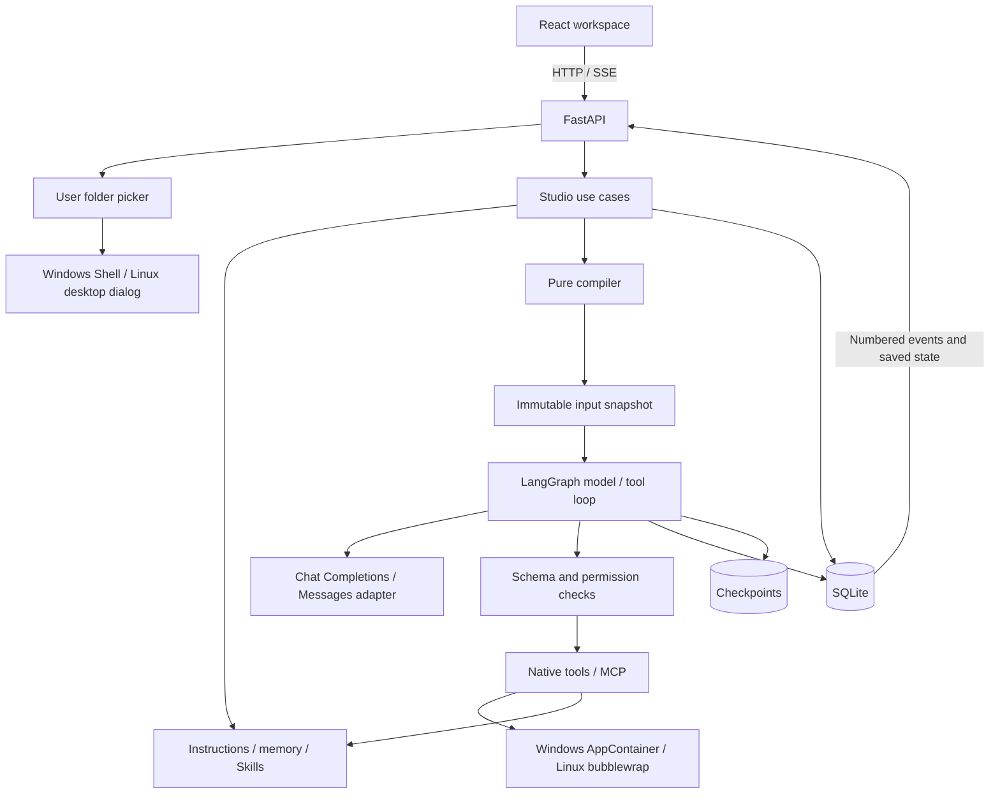
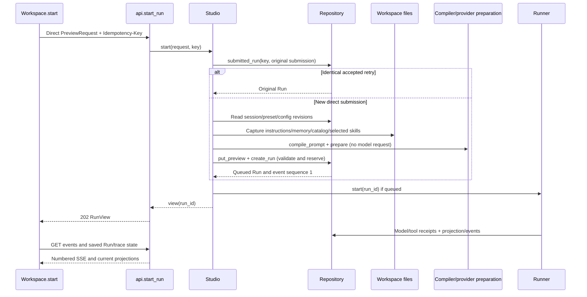
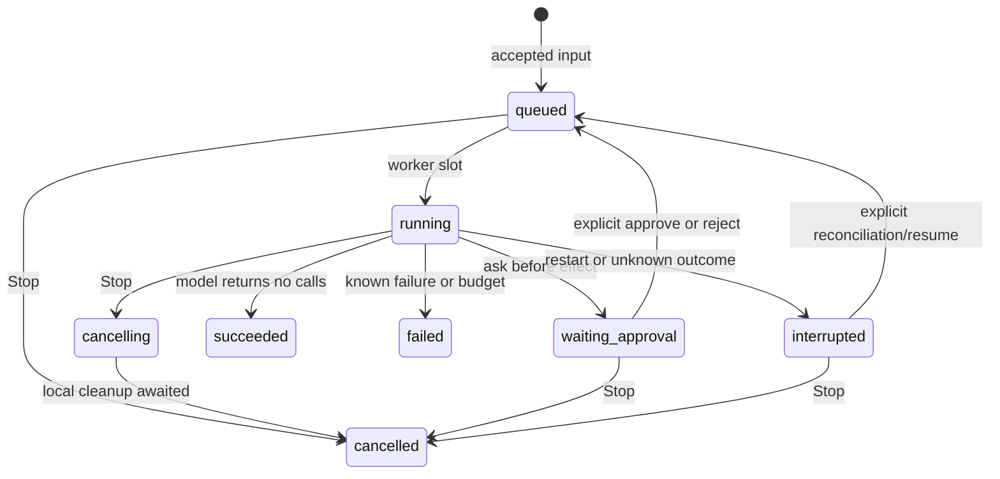

# Architecture and Design

Last updated: 2026-10-05. This describes implemented behavior. The [code and architecture review](review-2026-10-05.md) records maintenance findings and validation. Future work is defined in the [delivery stages](README.md#delivery-stages).

## Read from the whole system to individual functions

This page explains the system's shape, resource ownership, data flow, and design choices. The [Architecture Reference](reference/README.md) follows those boundaries down to **every implemented module, class, named function/method, nested helper, and anonymous callback**. Each entry explains purpose, mechanism, reason, layer, architectural role, and source location. [Engineering](reference/engineering.md) also explains every declared dependency package, migration, script, and supporting test function.

| Detail to inspect | Reference |
| --- | --- |
| Data contracts, process settings, compilation, policy, redaction | [Backend core](reference/backend-core.md) |
| Composition root, Studio actions, exact HTTP/SSE handlers | [Application and transport](reference/backend-application.md) |
| Model serialization/capture, graph nodes, budgets, receipts, recovery | [Execution](reference/backend-execution.md) |
| Tables, version checks, transactions, history copies/deletion | [Storage](reference/backend-storage.md) |
| File context, memory, Skills, tool schemas/dispatch, native OS isolation | [Workspace and tools](reference/backend-workspace.md) |
| Components, query state, drafts, handlers, responsive layouts | [Frontend](reference/frontend.md) |
| Dependencies, tooling, schema upgrades, verification functions | [Engineering](reference/engineering.md) |
| Local predicates, effects, state updaters, and event closures | [Callbacks](reference/callbacks.md) |

## What the application owns

The product takes a task, composes its initial model input from visible configuration and workspace context, executes one bounded agent loop, and preserves the evidence. A conversation organizes turns; each new turn creates a Run with its own immutable input and graph thread. Prompt editing is one way to control those inputs. It does not replace the task-to-execution workflow.

The browser and attached clients talk to local HTTP; model adapters talk to explicitly configured endpoints; native commands execute inside an OS sandbox; MCP talks to explicit external processes/services; bounded downloads have a separate public HTTPS boundary. Trusted local Python handlers execute inside the application. SQLite and ordinary context files are local persistence. Permissions and lifetimes differ across these paths, so one universal plugin/sandbox abstraction would misdescribe the implementation.

### Actual repository layout

```text
src/rtagent/                    One installable Python package
  __init__.py                  Package version; no worker
  main.py                      Composition root, lifespan, local browser boundary, SPA
  desktop.py, windows_dialog.py User folder selection, helper process and COM lifetime
  config.py                    Process environment/paths and secret references
  api.py                       HTTP routes, validated contracts, SSE serialization
  application.py               Studio use cases and Run command coordination
  harness.py                   Shared Web/embedded lifecycle and typed Run facade
  client.py, cli.py, rpc.py     Existing-service HTTP attachment, CLI and newline JSON-RPC
  domain.py                    Strict data contracts and canonical utility values
  prompts.py                   Pure compilation, conditions, variables, source mapping
  patches.py                   Pure Add/Update/Delete parsing and exact text hunks
  policies.py                  Frozen-schema argument validation and allow/ask/deny
  runtime.py                   Explicit LangGraph loop, tasks, budgets, receipts/reentry
  providers.py                 LangChain adapter, prepared/captured requests, fake stream
  anthropic.py                 Explicit Messages text/tool serializer and SSE parser
  context.py                   Source-bound no-tools compaction and usage receipts
  hooks.py, execution.py       Trusted callbacks and per-dispatch Run/session ownership
  tools.py                     Native schemas, stateless MCP lifecycle, one-call dispatch
  workspace.py                 Guarded files and file-backed instructions/memory/Skills
  sandbox.py                   Linux bubblewrap/Bash and process-group cleanup
  windows_sandbox.py           Win32 AppContainer/PowerShell/Job Object lifecycle
  sandbox_files.py             Windows filtered copy and conflict-checked reconciliation
  command_io.py, processes.py  Bounded live pipes/output and original native process ownership
  toolchains.py, downloads.py  Trusted read-only runtime staging and pinned public HTTPS transfer
  packages.py                  New-identity preset and validated Skill data import/export
  storage.py                   SQLAlchemy Core tables/transactions/events/copies
  tracing.py                   Sanitized evidence copies
  skills/skill-creator/         Packaged SKILL.md resource
  skills/debugging/            Packaged reproduce/diagnose/verify procedure
  skills/code-review/          Packaged evidence-based review procedure
web/src/                       React presentation and local editor state
  main.tsx, App.tsx            Browser bootstrap and workspace coordination
  ConversationTurn.tsx         Saved turn, tool evidence and recovery presentation
  DirectoryField.tsx           Native folder selection and unavailable fallback
  useDialogFocus.ts            Modal keyboard focus and restoration
  Composer.tsx                 Prompt block controls and rule drafts
  usePresetDrafts.ts           Independent bounded undo/redo histories
  useLivePreview.ts            Debounced draft compilation and stale-response handling
  Projects.tsx                 Named workspace registration and navigation
  ConversationHistory.tsx     History groups, menus, and copy/metadata dialogs
  Inspector.tsx                Preview versus actual call evidence
  Settings.tsx                 Versioned execution configuration editor
  ToolCatalog.tsx             Grouped schemas and effective permission inspection
  TaskPlan.tsx                Recorded progress within its owning Run
  WorkspacePanel.tsx           Memory/skill editors and sandbox inspection
  ContextPanel.tsx             Explicit compaction/accounting/restoration
  ProcessesPanel.tsx           Owned output, pipe input/EOF and Stop
  PackageActions.tsx           Shared explicit JSON data import/export
  api/client.ts                Same-origin JSON transport and generated type aliases
  api/events.ts                Persistent event subscription/query invalidation
  api/generated.ts             Generated type-only OpenAPI contract
  style.css                    Visual hierarchy, fixed/scroll areas, responsive behavior
migrations/                    Application schema history, separate from checkpoints
scripts/                       Contract export and isolated real-HTTP smoke checks
tests/, web/e2e/               Backend/component/browser verification
docs/                          Project guide, system design, development/reference
```

This is the current layout. Responsibilities are modules, not all separate packages. Splitting them further requires a concrete need; the design does not assume microservices, a plugin marketplace, a vector store, or a second persistence backend.

### Layers and reasons for the boundaries

| Layer | Concrete owner | What it does / how it connects | Why this boundary exists |
| --- | --- | --- | --- |
| Presentation and local UI state | React components, usePresetDrafts, style.css | Displays saved projections and collects explicit task/editor/action input. | Drafts/selection/layout are browser concerns; authorization and effects are server concerns. |
| Transport | api.py, main.LocalAccessMiddleware, browser client/events | Validates/serializes HTTP contracts, preserves ASGI streaming/disconnect and reads persistent SSE; delegates actions. | Opening/reconnecting UI is a read operation, not implicit model execution. |
| Application use cases | Studio | Resolves revisions/context, freezes input, starts/approves/resumes/stops, coordinates checkpoint deletion. | Multi-step behavior has one owner independent of route rendering and graph-node internals. |
| Domain computation and policy | domain.py, prompts.py, patches.py, policies.py | Represents values, deterministically compiles, computes exact text hunks, validates arguments, returns a configured decision. | Computation cannot bypass the adapter that owns file paths/effects; no network/database/model SDK hides effects in compilation or authorization. |
| Runtime orchestration | Runner / LangGraph | Orders model/tool steps, checkpoints progress, enforces budgets, persists receipts and interrupts. | One explicit loop makes control flow and recovery visible; model adapters do not nest another loop. |
| Concrete infrastructure | providers/tools/workspace/sandboxes/config | Talks to SDKs/OS/files/transports and resolves credential references at their boundary. | The external system decides execution mechanics; the model cannot select an unrestricted host implementation. |
| Persistence and evidence | Repository, AsyncSqliteSaver, tracing | Stores application ownership/projections/receipts and separate graph progress; creates redacted copies. | Durable evidence and progress are different facts, and sanitizing a view must not rewrite originals. |
| Composition and engineering | main, migrations, export/smoke/tests/config | Owns lifetime, migrations, contract generation, and validation. | Resource startup/cleanup and development tooling do not belong in task prompts or frontend flows. |

These are responsibility layers, not a promise of a strict dependency-inverted framework. Studio directly calls the concrete Runner/Repository/ToolRegistry and provider preparation functions. Simple metadata routes delegate to Repository when no additional use case is needed; complicated execution/deletion goes through Studio. Domain/compiler/policy depend only on validated data and local computation. The entry point wires implementations and owns their lifetime. Detailed references identify the actual imports/effects, including these practical cross-layer calls.

### State and authority

| State | Authority / location | Lifetime and architectural role |
| --- | --- | --- |
| Process settings | Settings, environment/.env | Paths and startup overrides for one service process; not model-editable. |
| Current execution settings | settings row, StudioConfig revision | Edited explicitly; new Runs freeze a copy. Contains references, not actual secrets. |
| Current preset | presets row, embedded Block values/revision | Editable aggregate; old Run copies never follow later edits. |
| Project registration | projects and sessions.project_id | One existing absolute folder per Project; null sessions use the process default. Future Runs bind to session membership. |
| Live draft inspection | useLivePreview and POST /prompts/inspect | No preset/session/preview writes; retain previous valid output and abort superseded requests. |
| Successful history | sessions.messages | Only succeeded turns become subsequent model input; all other turns remain inspectable separately. |
| Prepared input | previews JSON with 15-minute expiry | Same compiler path for optional inspection and direct Run; one consumption per preview. |
| Run snapshot | runs.snapshot | Original configuration/history/task/schema/context/root/body, immutable through the Run and recovery. |
| Runtime projection | runs messages/status/approval/usage/partial output | Browser-visible current state; updated alongside numbered events. |
| Agent plan | RunView.plan derived from paired update_plan messages | A validated latest progress receipt, without a separate table, scheduler or mutable plan authority. |
| Effect receipts | calls table | Intent/result/uncertainty survives node replay and separately records what is known about dispatch. |
| Graph position | checkpoints.db, thread_id=run_id | LangGraph's node state; original Run only, never cloned by duplicate/fork. |
| Instructions/memory/Skills | Ordinary workspace/package files | Initial text is snapshotted; later explicit reads/writes are new recorded tool effects. |
| UI drafts/navigation | Component state and selected session ID | Page-local editing/selection; not execution authority or durable model history. |

The model can propose a ToolCall, not change this ownership. File/tool/model text is data. The server matches its original ID, validates against frozen schemas, enforces local allow/ask/deny and adapter boundaries, then returns matching evidence. An ask decision is a persisted human action for one invocation. Credential references are frozen, while their actual environment values resolve when the provider/MCP call executes; snapshots do not preserve old secret values.

### Resource lifetime and concurrency

`main.create_app` registers behavior without opening runtime stores. Its lifespan enters the shared Harness, which resolves directories, migrates/seeds Repository, applies explicit startup overrides and opens the checkpoint saver/graph to classify queued/stranded work. The Web lifespan also owns FolderPicker; the chooser opens only on an explicit request. Shutdown stops summary tasks, always stops/gathers Runs and native processes, always closes checkpoints, then disposes application connections through nested finally blocks. The Web owner always closes its dialog helper. Earlier cleanup failure cannot skip later resource release.

Studio's command lock sequences start/approval/resume/cancel/deletion commands within this process. Repository's writer lock protects short SQLite transactions; it is not held across model/tool execution. Runner's semaphore allows one graph invocation at a time, across conversations. A waiting approval ends that invocation and releases the slot, while its conversation remains reserved by active_run_id. Workspace's RLock serializes native guarded file replacements and Windows reconciliation, separate from database locks. Linux subprocesses use async I/O; blocking file/Win32 operations run off the event loop. One Uvicorn worker is the supported ownership model.

The application does not claim atomicity across model services, workspace edits, app.db, and checkpoints.db. Receipts/checkpoint reuse and explicit uncertainty are how it recovers when those boundaries cannot commit together. Stop awaits local cleanup; it cannot undo a completed file write or remote effect.

Live process input captures its controller/task/data together before reading settings and rechecks completion after that await. A retired process returns a conflict without map lookup failure, queued input or a new running receipt. Its persisted ID does not recreate a live capability. Folder selection has a separate process-local lock and async helper; request disconnect, timeout and shutdown terminate/reap that owned helper without blocking the agent loop.

## Application shape

One local FastAPI process owns one LangGraph worker, SQLite persistence, root-bound concrete workspace tools, and the React Web UI. Each responsibility is a module, without generic service interfaces, brokers, or a plugin runtime.



| Module | Responsibility |
| --- | --- |
| main.py, harness.py, config.py | Shared startup, migrations, resource ownership, ASGI boundary, static UI |
| desktop.py, windows_dialog.py | User folder selection, helper ownership, Windows Shell COM and manual fallback outcomes |
| api.py, application.py | HTTP contracts; resolve context/revisions, start/approve/cancel/resume Runs, workspace editing |
| client.py, cli.py, rpc.py | HTTP attachment and typed CLI/JSON-RPC operations on the existing owner |
| domain.py, prompts.py, patches.py | Pydantic contracts; pure compilation, validated plan projection, and exact text-patch computation |
| providers.py, anthropic.py | Canonical mapping, prepared/captured requests and explicit provider streaming |
| context.py, hooks.py, execution.py | Source-bound compaction, committed observation/additional guards and effect ownership |
| runtime.py | Bounded graph, checkpoints, receipts, interrupts and recovery |
| policies.py, tools.py | Frozen schemas/permissions, native dispatch, stateless MCP lifecycle |
| workspace.py, sandbox.py, windows_sandbox.py, sandbox_files.py | File context, memory, Skills, guarded edits, native Windows/Linux isolation and Windows file reconciliation |
| command_io.py, processes.py, toolchains.py, downloads.py, packages.py | Bounded pipes/live commands, trusted runtimes, pinned public transfer and reusable data formats |
| storage.py, tracing.py | Transactions, revisions, events, traces, redaction and export |
| web/src/ | Conversation, Prompt, Inspector, Workspace and Settings, generated API types |

Domain/compiler/policy logic does not depend on HTTP or storage. The application reads workspace files before pure compilation. Blocking file operations run in a worker thread; model/MCP/subprocess calls use async I/O. The entry point closes tasks, checkpoints, and database resources.

## One task through the concrete functions



HTTP acceptance is separate from completion. The background graph uses the saved Run even if the browser closes. UI start keeps a submission key only until it has an accepted response; a lost response can be retried unchanged. Browser Preview uses `Studio.inspect` with an inline unsaved preset and optional project/session references. `Studio._prepare` shares file capture, compilation, and provider preparation with execution; inspection never creates persistent input records. The API also retains `Studio.preview` / `StartRun` for clients explicitly consuming a saved immutable preview. Direct Run always captures current saved input independently.

### Each model/tool cycle

| Step | Concrete functions | State/effect and reason |
| --- | --- | --- |
| Reconstruct model input | Runner.model_node → compile_prompt → prepare | Frozen history/context/config plus current Run delta; first body must equal saved input. |
| Record/send one request | Repository.save_call → generate/capture → on_wire | Persist intent and application body before transmission; no SDK retry. |
| Stream/save response | Repository.delta / save_call / emit | Partial text is persistent; full response/call IDs/usage are recorded before graph progress. |
| Choose graph route | Runner.open conditional callbacks | No pending tools means completion; otherwise execute the pending batch in order. |
| Check one intent | Runner.tool_node → decide | Frozen schema/permission; invalid/denied calls receive matching errors instead of unauthorized effects. |
| Pause if required | interrupt → Studio.approve → Runner resume | Human decision precedes dispatch and survives restart/reentry. |
| Dispatch real tool | save_call(executing) → ToolRegistry.execute | File adapter/native OS boundary/MCP schema check owns the concrete effect. |
| Preserve outcome | save_call(result) → paired tool Message → emit | Matching original tool_call_id, reusable receipt, or explicit outcome_unknown before any retry. |
| Commit successful turn | Runner.drive → Repository.finish | Append one task plus delta to history and release session in one transaction. |

### Run states and user actions



Terminal means succeeded, failed, or cancelled. Waiting/interrupted keeps the conversation active and prevents archive/copy/delete until resolved or cancelled. A denied tool can still lead to a succeeded Run because the model receives a paired error and chooses a final response; tool permission outcome and Run completion are different facts. Shutdown keeps pending human approvals; abandoned dispatched calls become uncertain. Reading history or reconnecting events makes no state transition in this diagram.

### Other vertical workflows

| User action | Concrete path | Result / design reason |
| --- | --- | --- |
| Edit and save a preset | Composer → usePresetDrafts → Workspace.savePreset → save_preset | Local undoable content becomes a new aggregate revision; snapshots remain immutable. |
| Change settings/discover MCP | Settings.save → Studio.save_config / ToolRegistry.discover | New config revision, explicit fresh discovery, tools still disabled until allowed/asked. |
| Save note/procedure | MemoryEditor/SkillEditor → Studio → Workspace.write/save_skill | Same hash/file-format checks as model tools; refresh context and recompile a live draft while retaining the last valid result. |
| Inspect tools | Tools/Settings → ToolCatalog → bootstrap schemas/config | Grouped arguments and effective exposure; Settings alone saves permission changes. |
| Update progress | model → update_plan → paired tool message → Studio.view → TaskPlan | Validated progress survives refresh/restart/copies through existing evidence, without new state storage. |
| Apply focused changes | model → apply_patch → parse_patch/apply_hunks → Workspace | Validate all contexts/hashes, apply per-file changes, and return bounded diff/partial-failure evidence. |
| Duplicate/fork | History.copy or turn fork → Repository.copy_session | New owned evidence IDs/provenance, successful prefix history, zero model/tool replay. |
| Rename/move/archive | History.update → Repository.update_session | Revisioned metadata; archive requires idle, execution requires restoration. |
| Delete folder | History.submit → Repository.delete_folder | Members become Unfiled and their revisions advance; history remains. |
| Delete conversation | History.submit → Studio.delete_session → checkpointer/Repository | Idle-only owned checkpoint/evidence cleanup; independent copies remain. |
| Inspect/export | Inspector → trace/export handlers → redact | Canonical/prepared/wire/results are distinct; original local view is explicit, export is labeled non-replayable. |

## Direct Run and optional Preview

POST /api/v1/runs accepts a direct task:

```json
{
  "session_id": "existing-session-id",
  "expected_session_revision": 0,
  "preset_id": "existing-preset-id",
  "preset_revision": 1,
  "config_revision": 1,
  "input": "Inspect the project and fix the startup error.",
  "variables": {},
  "skills": []
}
```

Supply an Idempotency-Key header. A retry is resolved by key and the original submission fingerprint before revision checks. A new direct submission resolves the session/preset/settings, captures workspace context, compiles, and internally persists the frozen input. Run creation and session reservation are transactional. No UI preview is required.

POST /prompts/preview accepts the same body and returns messages, source map, activation report, estimate, prepared payload, and hash. To use that inspected input, send preview_id, input_hash, and expected_session_revision to /runs. A preview expires after 15 minutes and can create at most one Run. Stale preset/config/session revisions fail; changed workspace files do not mutate an existing input snapshot.

Both paths snapshot the preset, config, schemas, history, input, variables, initial workspace context, root path, and prepared request. Round zero must serialize to that request. Later rounds compile the same snapshot plus assistant/tool messages. They are not individually approved previews.

Idempotent retry returns the original Run even after session revision changes; a different body with the same key returns 409. The UI retains a key across a failed-response retry of unchanged input. Refresh and SSE reconnect only retrieve existing state.

## Prompt composition

Blocks support system/user/assistant roles, enabled state, placement/order, provider/model filters, declared variables, and a condition. Presets own embedded blocks and one revision; there is no separate block-version framework.

Message order:

1. Active before_history blocks sorted by order.
2. Recorded runtime environment, frozen root instructions, memory, Skill catalog, and explicitly selected Skill bodies.
3. Committed successful conversation history.
4. Active before_input blocks sorted by order.
5. Current user input exactly once.
6. This Run's assistant/tool messages.

Duplicate block IDs anywhere in a preset and duplicate orders within a placement fail. Every block retains its inclusion/exclusion reason; every message has a source. Workspace text is literal, not a template.

Variables use declared names such as {{task_type}}, with string/number/boolean types and explicit defaults. No code evaluation, attribute access, filesystem access, or arbitrary template execution occurs. Conditions support all/any/not and field/op/value with eq/in/exists. Fields are provider, model, task_type, tools, or one variables.name. Invalid or missing operands fail.

Estimates use serialized bytes divided by four. A configured context window reserves output and rejects estimated overflow; unknown context remains unverified. There is no implicit trimming. Actual provider usage is separate and unknown values stay null.

Five built-in presets use six independent editable common blocks and one task-focus block. They influence how the model works, not which tools it is allowed to execute. `Repository.initialize` seeds missing presets and upgrades only exact unchanged shipped fingerprints (including historical Security starters). Common blocks now describe pipes/background deadlines, trusted runtimes, explicit download policy and the uncertainty of derived history. The application adds `runtime:environment` to captured context: root, OS/native command language, sandbox mode, no-network command behavior, actual tool names, bounds, configured runtime roots/packages/download hosts and process semantics. This message appears in Preview, the snapshot and every canonical model request; it is not an unrecorded system instruction or a claim that a readiness probe passed.

## Workspace context, memory, and Skills

STUDIO_WORKSPACE_ROOT is the default process root. A trusted user can register an existing absolute folder as a Project; sessions store nullable project_id. Studio resolves that ID for inspection and new Runs, captures the root and project ID, and uses ToolRegistry.for_workspace to bind native file adapters and OS sandboxes. Runner dispatches from the frozen Run root, including after restart or a conversation move. Current catalog/error discovery is shared; explicit MCP transports remain outside native command isolation. Project roots are fixed registrations, not model-editable tool parameters. Changing an idle session’s Project advances its revision; active moves fail. Historical snapshots and copied wire evidence do not change.

Registration first uses DirectoryField → `/desktop/folder-picker` → FolderPicker. Windows runs a stdlib helper using IFileOpenDialog/FOS_PICKFOLDERS with COM STA ownership and Unicode filesystem paths. Linux uses an installed desktop dialog when its display is available. The parent invokes the real Windows interpreter rather than a venv redirector, owns the helper handle, and reaps it on cancellation/disconnect/shutdown. `selected` updates the field, `cancelled` preserves it, and `unavailable` exposes manual entry. Selecting a folder does not register a project, copy files or execute an agent tool; Studio.create_project validates/persists the explicit subsequent form action.

Within the selected root, the first nonempty AGENTS.override.md or AGENTS.md is captured with `workspace:<relative path>`; memory uses workspace:memory. The catalog source is workspace:skills; selected bodies use skill:<name>. Context is frozen once per Run and is not persisted as repeated conversation turns. `read_instructions(path)` explicitly reads the root-to-directory/file-parent chain, selecting override before AGENTS at each level, returning paths/text/hashes with deeper precedence, and rejecting combined input above 32 KiB. Markdown links are not automatically followed.

Memory is explicit Markdown, not hidden summarization. Reads return text/hash; save_memory requires that hash. Atomic replacement avoids partial files; stale hashes reject concurrent native edits. Shell/external edits are outside this lock, so this is not a transaction across host processes. Changes become initial context on the next Run; a current Run can read updated files explicitly and record the tool result.

Skills are discovered under .agents/skills/<name>/SKILL.md plus the packaged skill-creator, debugging and code-review procedures. YAML frontmatter requires a matching lowercase hyphenated name and a description. Only metadata enters the catalog. load_skill, explicit Prompt/Workspace selection, or $skill-name loads the body. Invalid entries are reported; discovery is bounded to 100 entries. Workspace skills cannot shadow bundled skills.

save_skill writes validated frontmatter and Markdown instructions; updates require the current hash. The bundled creator uses those tools to author and verify a focused reusable workflow. Supporting resources remain ordinary files. Skills cannot grant permissions, load host plugins, or bypass the sandbox.

## Tools and OS isolation

The model receives frozen schemas selected from the configured permission map and available catalog. Read-only mode excludes native mutation tools. Each call is JSON-schema checked and evaluated as allow, ask, or deny before effects occur. Prompt, memory, Skill, and tool-result text cannot broaden permissions.

The twenty native tools are list_files, search_files, search_text, read_text, read_instructions, write_text, edit_text, apply_patch, update_plan, powershell (Windows) or bash (Linux), read_memory, save_memory, load_skill, save_skill, echo, start_process, poll_process, send_process_input, stop_process and fetch_url. The [workspace reference](reference/backend-workspace.md#native-tool-surface) lists contracts and bounds. Tools/Settings use the same catalog; the backend independently checks native and trusted-local mutator declarations in read-only mode.

File tools require relative paths and reject traversal, links/junctions, credential paths, Git metadata, runtime data, and dependency directories. UTF-8 files and serialized outputs are bounded. Replacement uses a content hash; edits require one exact match. These application checks assume a non-hostile concurrent host environment.

Ranged reads accept files up to 2 MiB but return at most 500 lines and a bounded excerpt with the complete text hash and continuation metadata. Literal search scans at most 1,000 files/8 MiB; traversal itself caps at 10,000 entries. Skipped and truncated results are explicit. Regex and unrestricted host processes are unnecessary for this initial search surface. Ordinary memory/Skill reads and direct writes retain their 64 KiB cap.

The patch flow separates pure computation from file effects. `parse_patch` produces up to twenty immutable Add/Update/Delete operations from a patch up to 64 KiB. `apply_hunks` requires unique exact ordered line contexts and preserves unrelated endings. `Workspace.apply_patch` resolves allowed paths, rejects aliases, validates existing-file hashes, computes all replacements and bounds the diff manifest before any write. `_replace` atomically replaces one file up to 2 MiB; deletes recheck the hash. A later I/O/conflict failure returns `partial_patch` with the completed-file manifest and failed path. Cross-file atomicity is not claimed. Runtime retains these details in the matching error receipt. Existing settings introduce the deletion-capable patch at Ask; explicit permissions and old snapshots are preserved.

`update_plan` validates one to twelve step labels/statuses and at most one in_progress item. It returns a complete JSON plan through the ordinary receipt path. `latest_plan` accepts only valid tool messages paired with assistant update_plan calls; Studio projects it in RunView. A folded TaskPlan component shows it alongside messages. There is no plan table or extra loop, and a completed step is not independent verification evidence.

WindowsSandbox launches the built-in Windows PowerShell in a new AppContainer for each call. CreateProcessW receives SECURITY_CAPABILITIES with no capabilities, so Windows denies network access. An explicit inherited-handle list contains only stdin/stdout/stderr. The process starts suspended, is assigned to a kill-on-close Job Object with a 32-process limit, then resumes. Completion, timeout, and cancellation terminate the whole Job; the server waits for zero active processes before copying results back. Blocking Windows calls run in a worker thread, with cancellation signalled by an event and cleanup awaited by the runtime.

A filtered private Windows workspace copy receives the AppContainer SID's read/execute or modify ACL. Scratch space is writable. Original project, user, and system ACLs remain unchanged. Excluded credentials never enter the copy, so filename case aliases cannot expose them. After cleanup, changed files are copied back with preflight content-hash checks against concurrent host edits. This is not a multi-file atomic transaction. Copies are bounded to 64 MiB and 10,000 entries; links, hard links, aliases, and special files are rejected. PowerShell gets a Workspace: drive rooted at the copy; this avoids granting directory traversal/listing rights on host drive roots. AppContainer retains normal access to shared Windows resources; it is not a VM or a promise to hide every public file. Git Bash's MSYS runtime is not supported in this AppContainer; Windows commands use PowerShell syntax.

BashSandbox runs only on Linux. Bubblewrap creates private mount/process/network namespaces, binds the project at /workspace, exposes read-only system binaries/libraries and private scratch storage, clears the environment, and masks excluded files. A trusted setsid driver reports its process group before untrusted output. Timeout/Stop kills that group; bubblewrap's parent-death behavior cleans up namespace children.

Both paths use explicit host process arguments, bounded retained output, no inherited credentials, and cleanup before returning a result. Only the command supplied to the chosen shell is executable script. Results include stdout/stderr, exit code, timeout/truncation, and sandbox metadata. Timeout can leave partial edits. Missing OS support fails without unrestricted fallback. Startup upgrades the old Windows bash permission to powershell, preserving allow/ask/deny and creating a new settings revision; existing Run snapshots are unchanged. Resuming an old Bash call on Windows reports that its tool is unavailable.

Background commands, explicit UTF-8 pipe input and streamed output use these same boundaries. Full PTY/ConPTY terminals, general shell networking, disk quotas and automatic host-toolchain import are outside Stage 3. See [AppContainer isolation](https://learn.microsoft.com/en-us/windows/win32/secauthz/implementing-an-appcontainer) for the Windows boundary.

MCP is outside the command sandbox: explicitly configured host processes or HTTP services use fresh SDK sessions per discovery/call. Namespaced schema hashes are checked before execution. Changed schemas stop the call, credentials use environment references, and new tools default to denied. Stateful analysis sessions are deferred.

## Runtime, recovery, and provider requests

The explicit graph is model → policy/tools → model; no calls means completion. One worker runs one graph invocation at a time; approval interrupts release it. Steps, tool counts, deadlines, and output bounds limit execution. Every original tool_call_id gets one success/error result before the model continues.

thread_id equals run_id. New turns create new Runs; recovery resumes the original checkpoint/snapshot. Reentrant nodes reuse known receipts; uncertain effects are never retried implicitly. Approvals precede effects. Executing calls interrupted by failure/cancellation become outcome-unknown. Recovery requires retry or a verified tool result; model calls can only be retried. Previous attempt evidence remains. Stop awaits cleanup but does not undo completed local/remote effects. Only successful turns enter history.

OPENAI_BASE_URL, OPENAI_MODEL, and STUDIO_PROVIDER override saved configuration at startup when present. API keys resolve on the server at execution and do not enter snapshots/frontend state. Settings changes apply to new Runs immediately, until explicit environment settings win again after restart.

The real Chat Completions adapter is default; a blank model fails clearly. Explicit simulation records no wire request. LangChain maps canonical roles/IDs; a prepared body is compared with the actual HTTP request before transmission. Role changes are rejected. Retries/provider fallbacks are disabled. Every call records canonical messages, prepared/captured application-level bodies, sources, transformations, metadata and usage. Provider-internal additions are not visible.

## Persistence, API, and UI

SQLite tables: settings, presets, conversation_folders, projects, sessions, previews, runs, events, calls, compactions and processes. Alembic manages these; LangGraph manages its separate checkpoint database. Migration 0005 creates the two new receipt tables and adds session selection/reservation columns in place, preserving existing parent rows and FK-owned history. Memory/Skills are files and plans derive from existing messages. UTC timestamps, stable IDs, and schema versions identify records.

A state projection and its numbered event commit together. Successful completion appends history and releases the session together. A session has one active Run. Settings use optimistic revisions; Run snapshots remain immutable. SSE sequence deduplication and active-state polling keep the UI current.

Actual routes under /api/v1:

| Group | Behavior |
| --- | --- |
| /health, /bootstrap | Availability, saved config/presets/sessions/folders/projects, tool catalog |
| /config, /presets/{id}, /tools/refresh | Versioned edits and explicit discovery |
| /presets/{id}/export, /presets/import | Versioned data export and new-identity preset import |
| /workspace, /workspace/memory, /workspace/skills | Selected-project sandbox/instructions/memory/Skills through optional project_id; /workspace/skills/{name} loads a body |
| /workspace/skills/{name}/export, /workspace/skills/import | Selected-project text-resource packages, with new-name-only validated publication |
| /projects | Register an existing named absolute workspace folder; membership is part of session metadata |
| /desktop/folder-picker | User OS folder chooser; selected/cancelled/unavailable, without project registration or model execution |
| /sessions, /sessions/{id}, /sessions/{id}/runs | Conversations, versioned metadata edits, deletion, and saved Run history |
| /sessions/{id}/copy | Duplicate all completed records or fork through a successful Run |
| /sessions/{id}/context, /compact, /compactions/{job} | Explicit reduction/accounting/restore, captured requests and cancellation |
| /sessions/{id}/processes | Original live process projections, /{process}/input and /{process}/stop |
| /folders, /folders/{id} | Create, rename, or delete flat conversation folders |
| /prompts/inspect, /prompts/preview, /runs | Nonpersisting live draft inspection, optional saved preview, or direct execution |
| /runs/{id} subresources | State, cancel, approval, recovery, events, trace, export |
| /runs/{id}/event-log | Finite numbered event pages for CLI/RPC/SDK reconnects |

Generated /openapi.json and frontend types define exact contracts. The UI opens Prompt, Inspector, Workspace and Tools only when needed. Run is enabled for nonempty input without a preview. Draft changes request a debounced current inspection while retaining the last valid result. File editor saves use hashes.

HTTP expected errors, field-validation failures and unexpected errors before response start share ErrorEnvelope with code/message/details/request_id. Field details omit submitted values; unexpected diagnostics log type/source locations with the same ID. Concrete ASGI middleware forwards receive unchanged, preserving SSE and desktop disconnect detection; an already streamed response cannot be replaced with another JSON body. Attached clients tolerate non-JSON failures, and RPC isolates unexpected operation errors to their response frame. Fingerprinted assets cache immutably; the index revalidates and missing assets return 404.

Conversation metadata includes archive state and optional folder membership. Renames and moves use observed session revisions; explicit titles survive the first Run. Archiving requires an idle conversation, and the server rejects execution until restoration. Folder deletion clears membership and advances affected revisions without deleting history. Schema migration adds columns in place so SQLite foreign-key cascades cannot discard existing Runs.

Duplicate/fork is a single business-data transaction. Duplicate retains all terminal Runs and committed history. Fork requires a successful Run boundary and rebuilds committed messages from successful turns through that point. Both assign new session, Run, and receipt IDs and preserve immutable source snapshots and request evidence. Run source_run_id and receipt provenance identify copied history; a new run.copied event records the copy instead of replaying original SSE events. Checkpoints are not copied and historical effects cannot be resumed or executed by copying. Source IDs are provenance strings without foreign-key ownership, so deleting a source leaves its copies intact. Subsequent turns use new Runs with the copied history and the current shared workspace/configuration.

The UI renders ConversationTurn components in one scroll region under a fixed history toolbar and above a fixed message dock. The sidebar has separate fixed search/filter controls and a scrolling folder/history list. Prompt controls and save/discard actions stay fixed while grouped message blocks scroll. Each preset has a page-local draft with bounded, reversible snapshots; switching preserves edits and saving updates the revision baseline. Menu/dialog actions derive current metadata from the latest projection while preserving their input draft across Run completion. A shared small focus hook traps modal Tab navigation and restores the previous connected control.

Workspace stores project/session as one selection and validates persisted IDs. An empty session stays a new draft; selecting a Project does not implicitly select its first conversation. Conversation-specific Context/process panels reset when that identity changes. The returned accepted Run enters the query cache immediately; terminal events and subscription cleanup flush bootstrap/Context/trace invalidations. For an unchanged task whose acceptance response is lost, Workspace retains the original body and idempotency key across revision changes. Definitive rejection clears that identity; transport uncertainty does not create a new submission.

The app binds to loopback without login/access tokens. TrustedHost and Origin/Sec-Fetch-Site checks reject foreign browser requests; local native clients can call directly. This is not remote deployment authentication. Original traces are explicit local views; exports are labeled redacted copies.

## Acceptance and next stages

Run the service and check actual behavior before growing tests. scripts/smoke_workspace.py starts a temporary HTTP server and exercises real OS effects in a disposable workspace. Focused checks protect compilation, pairing, request capture, snapshot consistency, recovery, and confidentiality. Browser checks cover direct Run, optional preview, approvals, cancellation, history, settings, and workspace editing.

scripts/smoke_conversations.py checks management through a separate real HTTP server: copy boundaries, trace provenance, stale revisions, archive/restore, folder operations, and continuation after source deletion. Browser checks exercise preset switching/undo and the complete conversation-menu workflow.

Substantial Windows coding/analysis acceptance has passed, including guarded multi-file changes, independent native checks, scoped instructions and read-only review. Stage 3/4 additionally passed a real multi-file CSV repair, background worker input/cleanup, explicit summary and continued CLI implementation, restarted approval and embedded trusted extension (41 model requests, 63 tool calls). See [Stage 3 acceptance](acceptance-stage3.md), [Stage 4 acceptance](acceptance-stage4.md), [Stage 2 acceptance](acceptance-stage2.md) and [Codex capability review](codex-gap-review.md). Specialized security integrations and evaluation remain later work; extra workers, databases or orchestration are not prerequisites.

## Explicit history reduction

The original committed session messages remain authoritative evidence. Context compaction is an explicit asynchronous job over a prefix of successful complete turns, retaining one to ten recent turns verbatim. Studio captures source revision/hash, configuration and any previous summary; Repository reserves the idle session so a new Run cannot race it. The reducer performs no-tools calls through the existing compiler/provider, chunks evidence at valid UTF-8 boundaries, adapts chunk size only to a declared context budget and records every canonical/prepared/actual request, offset, returned summary, metadata and usage. Call/time budgets apply. Failed, cancelled or crashed calls remain recorded; uncertain completion never retries automatically.

Only a complete success with the original revision and prefix digest still matching activates a summary, advancing the session revision. Effective history becomes one **user-role derived-evidence message**, sourced `context:compaction:<id>`, plus the untouched suffix. It does not acquire system authority or pretend to be an original tool result. Inspection and new Run snapshots freeze this effective history and selected compaction ID. Restore clears selection, not evidence. Copies receive a fresh summary record with provenance only when their copied prefix includes the covered messages; they never share active job ownership. Earlier immutable Runs and original chat stay unchanged. History estimates omit instructions/tool schemas and are labeled separately from full compiler estimates and actual provider usage.

## Command progress and owned processes

Runner sets an immutable per-dispatch ContextVar containing trusted Run/session identity and an optional output consumer. The command adapters publish incremental UTF-8 output through OutputRelay; only retained bounded prefixes enter persistence. Foreground calls update their executing receipt and numbered `tool.output` events before a final paired result. The active Run projection exposes that output to chat.

`start_process` persists intent, then starts the same native sandbox with stdin/stdout/stderr pipes. One ProcessManager owns at most four live controllers/tasks across project registries. Startup returns actual readiness/PID or a recorded setup failure; successful Runs may leave a process active. `poll_process`, explicit input/EOF and Stop act on original conversation/root ownership. Pipes have an 8 KiB input byte limit and sixteen queued frames; input receipts retain hashes/sizes/EOF/time rather than another text copy. Current read-only mode rejects input to an older writable process. Archive/delete/workspace moves reject active original writers. Conversation copies have no process rows or handles.

Native stop, absolute timeout, Run failure/cancellation and service exit terminate the owned Job/process group and await cleanup before finalization. Windows output appears live while workspace edits copy back only after exit; private copies do not become live shared development directories. Restart marks unfinished records interrupted with explicit uncertainty and never launches them again. Full terminal emulation is not implemented.

## Runtime and dependency boundary

Settings explicitly registers at most three trusted specific runtime folders. Filtered copies (20,000 entries/256 MiB total) are readable/executable in the sandbox, with no original ACL changes, ambient PATH or credential import. Preparation is deadline/cancellation-aware and awaited before removing staging directories. Python uses UTF-8 pipes and workspace `.rtagent/packages` with bytecode/index checks disabled for offline use.

`fetch_url` is a separate application tool under allow/ask/deny and read-only enforcement. Up to twenty exact configured public HTTPS hosts, port 443, a new relative destination, a 16 MiB cap and optional expected SHA-256 bound transfer. It rejects credentials, query/fragment, redirects, proxies and any non-global DNS answer. The client pins one global literal address while retaining the original Host and TLS SNI/certificate identity; DNS cannot change the destination after validation. This does not add command network capabilities. The host's VPN currently resolves some package hosts to reserved fake IPs, which production correctly refuses; the acceptance-only public-DNS fixture is documented separately.

## Shared clients and trusted extensions

Harness owns concrete application resources and their async lifetime. `create_app` enters that same Harness; embedded programs use their own data directory. AgentClient, CLI and JSON-RPC attach to a running owner through HTTP. They cannot open its databases as another worker or introduce a second loop. Explicit `start(request, key)` is the stable submission/retry primitive; convenience `run` captures current revisions. Disconnect/wait timeout is separate from cancellation, and clients return approval/interrupted states for explicit decisions. [Harness interfaces](harness.md) lists commands, protocol limits and examples.

Hooks are narrowly scoped trusted Python callbacks. Event observers receive redacted copies after commit, with bounded best-effort delivery and recorded failures; they cannot hold a transaction or change known effect outcomes. Tool guards run after core policy/approval, receive copies and can only add denial. Explicit local tool registration requires schemas, ordinary configuration permission and frozen-hash checks, defaulting to a declared mutator for read-only enforcement. Handlers run with trusted application authority, not as untrusted sandboxed code. Skills never register Python handlers. Web integrations supply `hooks` and `configure` at composition; no dynamic loader or generic plugin marketplace is introduced.

Reusable preset packages create new preset/block identities. Skill packages preflight bounded portable text paths and matching frontmatter, stage all resources and publish a new directory only after validation. Existing/bundled names remain protected. Imports do not execute resources, grant permissions or clone configuration, effects or checkpoints.

The second provider is an explicit Anthropic-compatible Messages adapter. It extracts leading system text into a top-level field and maps original assistant tool IDs/results to tool_use/tool_result blocks. Both Preview and receipts disclose transformations. Interleaved system blocks, unsupported content and incomplete streams fail instead of being silently relocated/dropped. Credentials resolve only at transport I/O, actual body equality is checked before sending, and unknown usage remains null. Real local HTTP protocol acceptance is separate from an unperformed external Claude endpoint check.

## Stage 2 acceptance

The Windows local-agent boundary is accepted through substantial real-model work in a registered project, native sandbox checks, per-project context/file checks, browser workflows, and existing-data migration checks. See [Stage 2 Acceptance](acceptance-stage2.md) for tasks, recorded call counts, verification commands, and unimplemented later-stage scope. This is not a claim that excluded host runtimes or network dependencies are available inside AppContainer.
