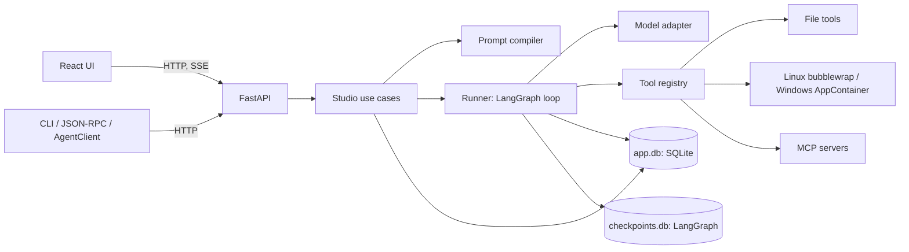
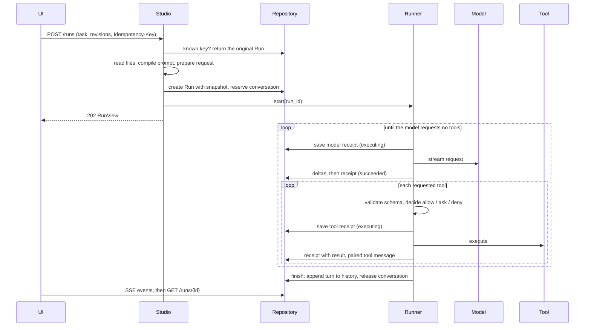
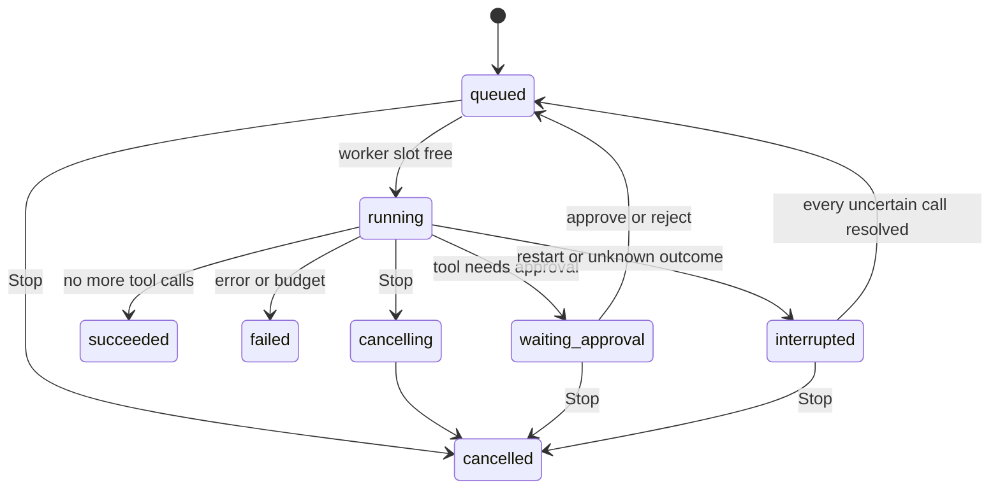

# Architecture

Last updated 2026-10-06. This describes the implemented system. The [project guide](README.md) covers usage; the [development guide](development.md) covers conventions and commands.

## Overview

One local Python process serves the Web UI and API, runs the agent, and owns all persistent state. There are no other services.



The central idea: **a task becomes an immutable Run snapshot, and everything the agent does is recorded against it.** The snapshot freezes the preset, settings, tool schemas, conversation history, workspace context and the exact first request. The loop then alternates model calls and tool calls, persisting a receipt for each before and after its effect, so a page refresh, a restart or a crash can always show (and safely resume) what happened.

## Source layout

```text
src/rtagent/
  domain/            Values and pure logic: models, prompt compiler, patch parser, permission
                     decision, lifecycle sets, hook and execution contracts. No I/O.
  application/       Use cases over concrete adapters:
    studio.py          Submissions, previews, approvals, recovery, projects, packages, context
    runner.py          The LangGraph model/tool loop, budgets, receipts and cancellation
    context.py         Explicit conversation compaction
  infrastructure/    Everything that talks to something external:
    storage.py         SQLite schema access, transactions, events, history copies
    config.py          Process settings and .env provider seeding
    credentials.py     API keys saved from Settings (server-side only)
    tools.py           Tool catalog, schemas, dispatch, MCP sessions
    providers/         OpenAI-compatible (chat.py), Anthropic Messages (messages.py),
                       model lists (catalog.py), errors
    workspace/         File tools, Skills and memory (files.py), downloads, trusted runtimes
    sandbox/           linux.py, windows.py, command output/stdin (command_io.py),
                       background processes (processes.py), Windows workspace copies (files.py)
    desktop/           Native folder picker
    packages.py        Preset and Skill package import/export
    tracing.py         Redacted views of evidence
  interfaces/        HTTP app and routes, AgentClient, CLI, JSON-RPC
  harness.py         Composition root: builds and owns Repository, ToolRegistry, Runner, Studio
  skills/            Bundled Skills (skill-creator, debugging, code-review)
migrations/          Alembic revisions for app.db
web/src/
  app/App.tsx        Workspace shell: selection, submission, panels, composer
  features/          chat, composer (model and access pickers), history, projects, prompts,
                     inspection, workspace, settings, tools
  shared/            Json, StatusBadge, PackageActions, Popover, useDialogFocus
  api/               Generated types, HTTP client, SSE subscription
```

Dependencies point inward: `domain` imports nothing else from the project; `infrastructure` imports only `domain`; `application` imports `domain` and `infrastructure`; `interfaces` and `harness.py` may import everything. In the frontend, `shared` and `api` never import `features` or `app`, and features never import `app`. `scripts/check_layers.py` enforces both rules. Application code calls concrete infrastructure classes directly; interfaces are introduced only when a second implementation exists (providers are the one case).

## How a task runs



**Submission.** `Studio.start` first resolves the idempotency key: a retry with the same key and body returns the original Run even if revisions changed since; the same key with a different body is a conflict. A new submission checks the conversation, preset and settings revisions the client observed, applies the Run's choices (below), captures workspace context, compiles, and prepares the provider request. `Repository.create_run` stores the snapshot and reserves the conversation in one transaction. Preview is optional: `POST /prompts/preview` saves the same compiled input for 15 minutes so a client can run exactly what it inspected, and `POST /prompts/inspect` compiles an unsaved draft without storing anything.

**Run choices.** A submission, preview, inspection or compaction may name a `model` (`provider_id`, `model`, `reasoning_effort`) and a workspace `access` (`read-only`, `ask`, `workspace-write`); omitted values use the saved default model and sandbox mode. `resolve_model` copies the provider's endpoint, key name and request options into a complete `ProviderConfig`, and `Studio._effective_config` applies the access to the saved permissions: read-only mounts the workspace read-only and removes tools that change files; ask turns every allowed tool that changes files, runs code or calls MCP into an approval. The result is frozen in the snapshot (`config.provider`, `access`), so later settings edits never change a Run, and Run views report the provider, model, effort and access that were used. Access only tightens: a tool denied in Settings stays denied.

**The loop.** `Runner` builds one LangGraph `StateGraph` with a `model` node and a `tools` node, checkpointed with `thread_id = run_id`. The graph state holds only this Run's new messages, the step number and the pending tool calls.

| Step | What happens | Why |
| --- | --- | --- |
| Rebuild input | Compile the snapshot plus this Run's messages; prepare the provider body. The first body must equal the snapshot's. | The model sees exactly what the snapshot promised. |
| Record intent | Save the model receipt with canonical messages and prepared body before sending. | A crash during the call leaves evidence of what was sent. |
| Capture the wire body | The HTTP client hook compares the outgoing JSON with the prepared body and refuses to send on mismatch. | The recorded request is the real one. |
| Stream | Deltas append to the Run's partial output with numbered events. | The UI follows progress; reconnects replay events. |
| Decide | Validate arguments against the frozen schema; look up allow/ask/deny; on ask, persist an approval and interrupt. | Authorization is data in the snapshot, never model text. |
| Execute | Save the tool receipt (executing), run it with the Run's frozen workspace root, save the result. | A replayed node reuses the receipt instead of repeating the effect. |
| Pair | Append a tool message with the original `tool_call_id`. | Every call gets exactly one result before the next model call. |
| Finish | When the model asks for no tools, append the task and messages to history and release the conversation in one transaction. | Only successful turns become future context. |

Budgets: model steps, total tool calls, a per-tool timeout and an active-time limit per Run (Settings → Run limits). Exceeding one fails the Run with a stated reason.

### Run states



A conversation has at most one active Run. Up to four Runs from different conversations execute at once (`MAX_ACTIVE_RUNS` in `runner.py`); further Runs wait as queued. A waiting approval releases its slot.

### Uncertain effects and recovery

If the process stops or a call times out while a model or tool call is executing, its outcome is unknown: the request may have reached the provider, the command may have changed files. Such receipts become `outcome_unknown` and the Run becomes `interrupted`. Resuming requires an explicit decision for every uncertain call: retry it, or (for tools) record a verified result. Nothing is retried automatically, and earlier attempts stay in the receipt's `attempt_history`. Stop and shutdown wait for local cleanup but cannot undo completed effects.

## Prompt compilation

`domain/prompts.compile_prompt` is pure: identical inputs give identical messages, sources and hash. Message order:

1. Preset blocks placed *before history*, by order.
2. Workspace context captured at submission: `runtime:environment` (root, sandbox, exposed tools, limits), root instructions, memory, Skill catalog, selected Skill bodies.
3. Committed conversation history (or a compaction summary plus recent turns).
4. Preset blocks placed *before input*, by order.
5. The task, exactly once.
6. This Run's assistant and tool messages.

Blocks have a role (system, user, assistant), optional provider/model allowlists and a condition (`all`/`any`/`not` over `field`/`op`/`value` with `eq`, `in`, `exists` on provider, model, task_type, tools or a variable). Templates substitute only declared `{{variables}}` of type string, number or boolean; there is no expression evaluation. Disabled or filtered blocks stay in the activation report with their reason. Duplicate block IDs or orders, missing variables and malformed conditions are errors, never silent omissions.

Token estimates are bytes ÷ 4. If Settings declare a context window, an estimate plus reserved output above it fails the compile; nothing is trimmed automatically. Actual usage comes from the provider and is `null` when unreported.

Built-in presets are seeded on start. A stored built-in preset is upgraded only if its content exactly matches a previously shipped version (`PREVIOUS_BUILTIN_HASHES`), so user edits are never overwritten.

## Data model

`app.db` (SQLite, WAL mode, managed by Alembic) holds application data; `checkpoints.db` belongs to LangGraph and is never edited directly.

| Table | Contents |
| --- | --- |
| `settings` | One versioned settings aggregate: providers (endpoint, adapter, key name, model list, temperature, output and context limits), the default model, tool permissions, default sandbox mode, runtimes, download hosts, MCP servers, limits. Stores credential *names* only. |
| `presets` | Versioned presets with embedded blocks. |
| `projects` | Registered workspace folders. |
| `conversation_folders` | Flat folders for organizing conversations. |
| `sessions` | Conversations: committed message history, revision, active Run, project, folder, archive flag, compaction pointers. |
| `previews` | Saved compiled inputs, deleted when consumed by a Run or expired. |
| `runs` | Immutable snapshot plus the live projection (status, messages, partial output, approval, usage). |
| `events` | Numbered events per Run for SSE replay. |
| `calls` | Model and tool receipts: intent, prepared and wire bodies, decision, result, attempts. |
| `compactions` | Summary jobs with source hash, provider calls and result. |
| `processes` | Background command records with bounded output. |

Outside the database, the data directory holds `credentials.json` (keys saved from Settings) and `skills/` (global Skills). Both are hidden from file tools and commands like the rest of the data directory.

Rules that keep this consistent:

- **Revisions.** Settings, presets, conversations and folders carry a revision; writes must name the revision they were based on, so a stale browser tab gets a conflict instead of overwriting.
- **One writer.** All writes go through `Repository` methods holding an asyncio lock for short transactions. A state change and its event commit together.
- **Snapshots are immutable.** Editing settings or presets never changes an existing Run. Run views read a few snapshot fields with `json_extract` instead of loading whole snapshots.
- **Copies are independent.** Duplicate and fork copy conversations, Runs and receipts with new IDs and `source_run_id` provenance, but never checkpoints or processes, and never re-execute anything.
- **Deletion is idle-only** and removes the conversation's Runs, receipts, events and checkpoints.

## Tools and permissions

`ToolRegistry` holds the catalog: twenty native tools, discovered MCP tools (namespaced `mcp_<server>_<name>_<hash>`) and trusted local tools registered by embedding code. At submission, the tools whose effective permission (after the Run's workspace access) is not `deny`, and in read-only mode that do not write, are frozen into the snapshot with their schema hashes. At dispatch:

1. The call is validated against the frozen JSON schema.
2. The frozen permission decides: allow, ask (persist approval, interrupt) or deny (return an error result).
3. An optional trusted `before_tool` guard may add a denial, never grant one.
4. The tool runs. MCP tools re-list the server's tools first and refuse to call if the schema hash changed; local tools are checked the same way.

MCP discovery runs when the user saves a server and automatically, once per server configuration, the first time prompts are prepared after a restart. Each MCP call opens a fresh session; servers run outside the sandbox under their own configuration.

## Workspace context

Each Run binds to one absolute workspace root, resolved from its conversation's project (or the default root) at submission and frozen in the snapshot. Moving an idle conversation affects only later Runs; historical Runs keep their root.

`Workspace` (`infrastructure/workspace/files.py`) owns file access under that root: path resolution that rejects traversal, links and private names; bounded reads (2 MiB files, 500 lines per call, 64 KiB results); hash-guarded writes and edits; literal search bounded to 10,000 entries, 1,000 files and 8 MiB; the patch format (`domain/patches.py` parses and applies hunks, the workspace preflights every file before writing any); memory; Skill discovery and validation across three scopes (bundled, global in the data directory, project in `.agents/skills`), where a name may exist in only one scope and a conflict is reported instead of shadowed; instruction chains with `AGENTS.override.md` taking precedence over `AGENTS.md` at each level.

Exclusions come from two lists: **private names** (`.env`, `.env.*` except `.env.example`, `.git`, `access-token`, database files) are hidden from everything, including commands; **dependency folders** (`.venv`, `node_modules`, `__pycache__`) are skipped by file tools and Windows copies but stay visible to Linux commands. The studio's own data directory is always hidden.

## Command sandboxes

Both sandboxes take the same inputs (command, working directory, mode, timeout, trusted runtimes) and return the same JSON result: stdout, stderr, exit code, timeout and truncation flags.

**Linux (`sandbox/linux.py`).** Each command starts `bwrap --unshare-all --die-with-parent --new-session` with: read-only `/usr` and `/etc` plus the host's `/bin`, `/lib*` and `/sbin` layout; fresh `/proc`, `/dev`, `/tmp` and home; the workspace bound at `/workspace` (read-only in read-only mode); private files and the data directory masked by empty files and read-only tmpfs; trusted runtimes bound read-only at their host paths and at `/toolchains/N`; a cleared environment. The network namespace has no interfaces. A small `setsid` driver reports the process group ID before the untrusted command starts, so timeout and Stop can kill the whole group. Links in the workspace are allowed: they resolve inside the sandbox's own mount namespace, where masked paths stay masked and unmounted host paths do not exist.

**Windows (`sandbox/windows.py`).** Each command creates a new AppContainer profile with no capabilities (so no network), copies the workspace minus excluded paths into a private directory (64 MiB / 10,000 entries), grants the container access to that copy only, and starts Windows PowerShell suspended inside a kill-on-close Job Object limited to 32 processes. After all processes exit, changed files are copied back, failing if the host copy changed meanwhile. Original ACLs are never modified.

**Output.** `command_io.OutputBuffer` keeps the first 8,000 and last 16,000 characters of each stream and marks how much was dropped in between; the final result is trimmed further only if JSON escaping would exceed the 64 KiB tool limit. While a command runs, `CommandOutput` publishes snapshots of the bounded text to the Run (every 0.1 s) or process record (every 0.5 s); `tool.output` events only signal progress.

**Background processes (`sandbox/processes.py`).** `start_process` runs the same sandbox with a stdin pipe and returns once the process has started. At most four run at a time. Each belongs to its original Run, conversation and workspace root, has an absolute deadline no later than the Run time limit, and accepts stdin writes of up to 8 KiB each through a bounded queue. Stop, deadline, Run failure or cancellation, and service shutdown kill the process tree. A restart marks unfinished processes interrupted; they are never relaunched. Archiving, deleting or moving a conversation with a running process is refused.

## Context compaction

Compaction (`application/context.py`) summarizes all but the last N successful turns. It reserves the idle conversation, feeds the older messages to the configured model in UTF-8-safe chunks with no tools, and records every request like a Run's model calls. The summary activates only if the conversation's revision and the hash of the covered messages still match; it becomes a single user-role message labelled as derived, followed by the untouched recent messages. The originals remain in history, previous Runs are unchanged, and restoring full context just clears the pointer. Failed, cancelled or interrupted jobs never activate.

## Providers

A **provider** (`ProviderProfile`) is one endpoint: adapter, base URL, key variable name, known model IDs and request options (temperature, max output tokens, context window). Settings hold any number of them plus a default model; `.env` values can seed the `openai` and `anthropic` providers at start-up (`Settings.apply_provider`). `catalog.list_models` reads a provider's `GET /models` (following the Messages API's pagination) to fill the model list. A default model that names a provider takes its connection from that provider; a `PUT /config` that changes the adapter under the same provider ID is rejected rather than silently rewritten.

**Keys.** `CredentialStore` resolves a key name to its value on the server only: a key saved in Settings (`credentials.json`, written atomically, mode 0600 on POSIX) first, then the process environment, then `.env`. The API accepts keys write-only and reports just their source and last four characters. Snapshots, traces, logs and the browser receive the name, never the value; provider errors redact the value before they are stored.

`providers/chat.py` prepares the request body with the same code for Preview and execution:

- **OpenAI-compatible:** LangChain's `ChatOpenAI` serializes Chat Completions with streaming and tool calls; retries are disabled. Reasoning effort is sent as `reasoning_effort` (low, medium, high). A request hook compares the real body with the prepared one before sending.
- **Anthropic Messages** (`providers/messages.py`): leading system messages become the `system` array, tool calls become `tool_use` blocks and results `tool_result` blocks. Effort is sent as `output_config.effort` (low through max); temperature is omitted unless set, because current Claude models reject non-default sampling. System messages inside the history, unsupported content blocks and incomplete streams are errors, and a classifier refusal (`stop_reason: "refusal"`) is reported as a declined request with its category.
- **Simulated:** offline canned replies that drive real tools from `/read`, `/echo` and `/tool` commands. Explicitly selected only.

**Thinking blocks.** Current Claude models think by default and return signed `thinking`/`redacted_thinking` blocks. The adapter keeps an assistant turn's exact content array (`Message.blocks`) and sends it back unchanged for the tool continuations of the same Run, as the API requires. When the turn becomes conversation history, the blocks are dropped and only text and tool calls remain: a signature is bound to the conversation prefix and model that produced it, and each Run recompiles its system prompt (memory, instructions, Skills may have changed) and may use another model, so replaying older blocks would be rejected. Stripping every earlier block keeps each request valid; within a Run the history is append-only. Browser views omit the blocks.

Failures report the provider's message and HTTP status with credentials redacted (`providers/errors.py`). Tool arguments cut off by the output token limit get a specific error.

## HTTP API

All routes live under `/api/v1` (`interfaces/http/api.py`); `/openapi.json` is the exact contract and `web/src/api/generated.ts` is generated from it.

| Area | Routes |
| --- | --- |
| Startup | `GET /health`, `GET /bootstrap` (settings, presets, conversation summaries, folders, projects, tool catalog) |
| Settings and tools | `PUT /config`, `POST /tools/refresh`, `PUT /presets/{id}`, preset export/import |
| Models and keys | `POST /providers/models` (list a provider's models), `GET /credentials?name=…` (status only), `PUT/DELETE /credentials/{name}` |
| Global Skills | `GET /skills`, `GET/DELETE /skills/{name}`, `PUT /skills` |
| Workspace | `GET /workspace`, `PUT /workspace/memory`, Skill get/save/export/import, all with optional `project_id` |
| Projects | `POST /projects`, `POST /desktop/folder-picker` |
| Conversations | `POST /sessions`, `GET/PATCH/DELETE /sessions/{id}`, `/copy`, `/runs`, `/context`, `/compact`, `/compactions/{id}`, `/processes` |
| Folders | `POST /folders`, `PATCH/DELETE /folders/{id}` |
| Prompts | `POST /prompts/inspect` (unsaved draft), `POST /prompts/preview` (saved, 15 minutes); both accept `model` and `access` |
| Runs | `POST /runs` (with optional `model` and `access`), `GET /runs/{id}`, `/cancel`, `/approvals/{id}`, `/resume`, `/trace`, `/export`, `/events` (SSE), `/event-log` (pages) |

Errors share one envelope: `{"error": {"code", "message", "details", "request_id"}}`. Validation errors list field locations without echoing submitted values; unexpected errors log their stack locations under the request ID.

**Events.** Each Run's events have consecutive sequence numbers. `GET /runs/{id}/events` replays from a cursor (`after` or `Last-Event-ID`) and follows until the Run ends; reconnecting never starts work. Event payloads are redacted; command output is read from the Run view rather than carried in events.

**Local access boundary.** The app binds to loopback. `TrustedHostMiddleware` accepts only loopback `Host` headers (defeating DNS rebinding), and browser requests to the API must come from the page's own origin or a configured development origin (`STUDIO_ALLOWED_ORIGINS`, Vite's port by default); cross-site fetches are rejected. There is no authentication: anything that can reach loopback as the user can use the API.

## Frontend

React with TanStack Query; `api/generated.ts` types every request. `App.tsx` owns the selection (project and conversation), the composer, the pending submission and which side panel is open. Server state is cached per query: `bootstrap`, `runs/<conversation>`, `trace/<run>`, `workspace/<project>`, `context/<conversation>`, `processes/<conversation>`.

While a Run is active, `useRunEvents` follows its SSE stream and refetches only that Run's projection (at most one request in flight, coalesced to 100 ms); broader queries refresh at lifecycle boundaries (tool completion, approvals) and when the Run ends. A slower poll covers a lost event stream. The Inspector loads the trace, which can be large, only while it is visible.

Settings (sidebar) edit global configuration in pages: Providers and keys, Models, Tools, MCP servers, Skills, Sandbox and Run limits. Configuration pages share one versioned draft saved together; keys and global Skills save immediately through their own routes. The composer's model and access pickers hold the choice for the next Run in `localStorage` (`studio.choice`, IDs only) and adopt the last Run's choice when a conversation opens; the Tools panel shows permissions with the selected access applied, mirroring the server's transformation.

A lost submission response is retried with the same body and idempotency key, even if the conversation advanced meanwhile, so it cannot create a second Run. Prompt edits are page-local drafts with undo history until saved. Styles use CSS custom properties with light and dark themes following the system setting.

## Clients and extensions

`AgentClient`, the CLI and JSON-RPC attach to a running service over HTTP; they never open its databases. `Harness` lets a Python program own the full stack instead (with its own data directory), register trusted local tools, and observe events or add tool denials through `Hooks`. See [Harness interfaces](harness.md).

## Design decisions and limits

- **One process, SQLite, no queue.** Sufficient for a single local user; LangGraph checkpoints plus receipts make restarts safe without a broker.
- **No hidden context management.** Over-budget prompts fail with a reason; compaction is an explicit, reversible action.
- **No claimed atomicity across systems.** A model call, a file write, `app.db` and `checkpoints.db` cannot commit together; receipts and explicit uncertainty handle the gaps.
- **Text is data.** Files, tool output, memory, Skills and model replies cannot change permissions or settings.
- **Not a security boundary against the local user.** The sandbox protects the host from agent commands; it does not authenticate local API clients. MCP servers and trusted local tools run with the service's own authority.
- **Not implemented:** terminal emulation, command networking, disk quotas, stateful MCP sessions, multi-user deployment.
