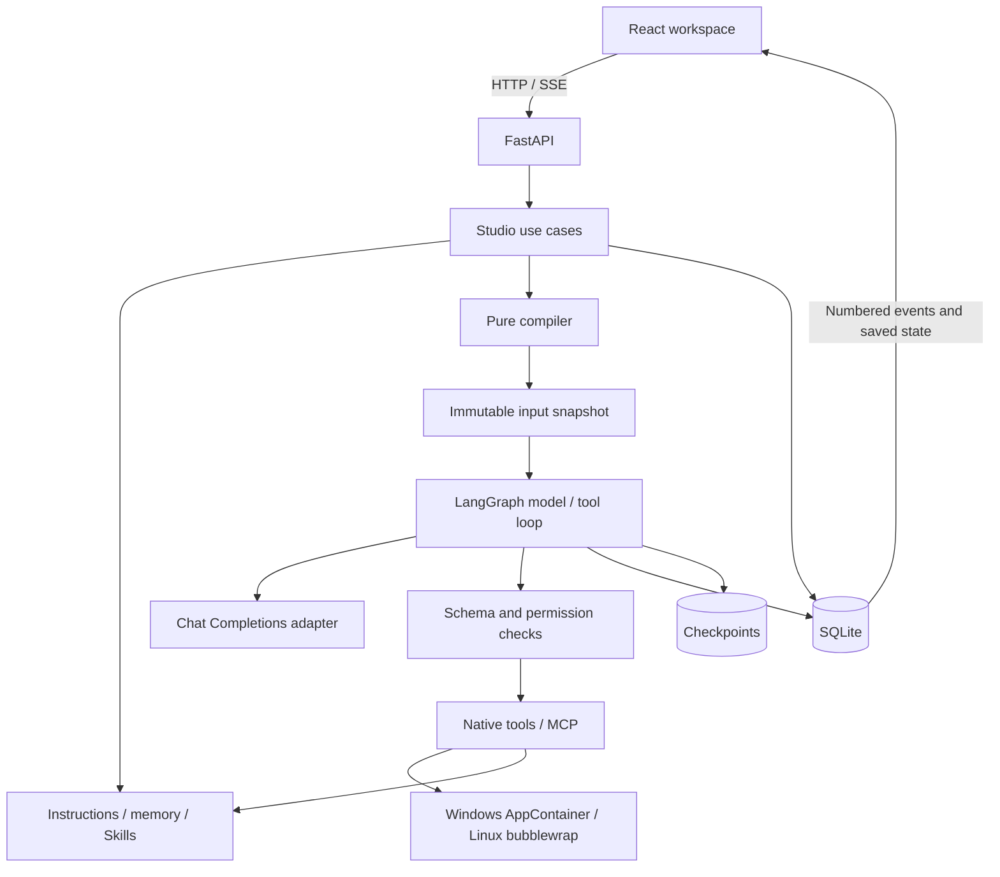

# Architecture and Design

Last updated: 2026-10-03. This describes implemented behavior. Future work is defined in the [README delivery stages](../README.md#delivery-stages).

## Application shape

One local FastAPI process owns one LangGraph worker, SQLite persistence, concrete workspace tools, and the React Web UI. Each responsibility is a module, without generic service interfaces, brokers, or a plugin runtime.



| Module | Responsibility |
| --- | --- |
| main.py, config.py | Startup, migrations, resource ownership, loopback boundary, static UI |
| api.py, application.py | HTTP contracts; resolve context/revisions, start/approve/cancel/resume Runs, workspace editing |
| domain.py, prompts.py | Pydantic contracts; pure ordering, activation, substitution, sources, estimates and hashes |
| providers.py | Canonical mapping, prepared requests, wire capture, real or explicit simulated streaming |
| runtime.py | Bounded graph, checkpoints, receipts, interrupts and recovery |
| policies.py, tools.py | Frozen schemas/permissions, native dispatch, stateless MCP lifecycle |
| workspace.py, sandbox.py, windows_sandbox.py, sandbox_files.py | File context, memory, Skills, guarded edits, native Windows/Linux isolation and Windows file reconciliation |
| storage.py, tracing.py | Transactions, revisions, events, traces, redaction and export |
| web/src/ | Conversation, Prompt, Inspector, Workspace and Settings, generated API types |

Domain/compiler/policy logic does not depend on HTTP or storage. The application reads workspace files before pure compilation. Blocking file operations run in a worker thread; model/MCP/subprocess calls use async I/O. The entry point closes tasks, checkpoints, and database resources.

## Direct Run and optional Preview

POST /api/v1/runs accepts a direct task:

```json
{
  "session_id": "existing-session-id",
  "expected_session_revision": 0,
  "preset_id": "existing-preset-id",
  "preset_revision": 1,
  "config_revision": 1,
  "input": "Inspect the project and fix the startup error.",
  "variables": {},
  "skills": []
}
```

Supply an Idempotency-Key header. A retry is resolved by key and the original submission fingerprint before revision checks. A new direct submission resolves the session/preset/settings, captures workspace context, compiles, and internally persists the frozen input. Run creation and session reservation are transactional. No UI preview is required.

POST /prompts/preview accepts the same body and returns messages, source map, activation report, estimate, prepared payload, and hash. To use that inspected input, send preview_id, input_hash, and expected_session_revision to /runs. A preview expires after 15 minutes and can create at most one Run. Stale preset/config/session revisions fail; changed workspace files do not mutate an existing input snapshot.

Both paths snapshot the preset, config, schemas, history, input, variables, initial workspace context, root path, and prepared request. Round zero must serialize to that request. Later rounds compile the same snapshot plus assistant/tool messages. They are not individually approved previews.

Idempotent retry returns the original Run even after session revision changes; a different body with the same key returns 409. The UI retains a key across a failed-response retry of unchanged input. Refresh and SSE reconnect only retrieve existing state.

## Prompt composition

Blocks support system/user/assistant roles, enabled state, placement/order, provider/model filters, declared variables, and a condition. Presets own embedded blocks and one revision; there is no separate block-version framework.

Message order:

1. Active before_history blocks sorted by order.
2. Frozen root instructions, memory, skill catalog, and explicitly selected skill bodies.
3. Committed successful conversation history.
4. Active before_input blocks sorted by order.
5. Current user input exactly once.
6. This Run's assistant/tool messages.

Duplicate block IDs/orders within a placement fail. Every block retains its inclusion/exclusion reason; every message has a source. Workspace text is literal, not a template.

Variables use declared names such as {{task_type}}, with string/number/boolean types and explicit defaults. No code evaluation, attribute access, filesystem access, or arbitrary template execution occurs. Conditions support all/any/not and field/op/value with eq/in/exists. Fields are provider, model, task_type, tools, or one variables.name. Invalid or missing operands fail.

Estimates use serialized bytes divided by four. A configured context window reserves output and rejects estimated overflow; unknown context remains unverified. There is no implicit trimming. Actual provider usage is separate and unknown values stay null.

## Workspace context, memory, and Skills

STUDIO_WORKSPACE_ROOT is process configuration, not model-controlled. Root AGENTS.md and .rtagent/MEMORY.md are captured with sources workspace:AGENTS.md and workspace:memory. The catalog source is workspace:skills; selected bodies use skill:<name>. Context is frozen once per Run and is not persisted as repeated conversation turns.

Memory is explicit Markdown, not hidden summarization. Reads return text/hash; save_memory requires that hash. Atomic replacement avoids partial files; stale hashes reject concurrent native edits. Shell/external edits are outside this lock, so this is not a transaction across host processes. Changes become initial context on the next Run; a current Run can read updated files explicitly and record the tool result.

Skills are discovered under .agents/skills/<name>/SKILL.md plus the packaged skill-creator. YAML frontmatter requires a matching lowercase hyphenated name and a description. Only metadata enters the catalog. load_skill, explicit Workspace selection, or $skill-name loads the body. Invalid entries are reported; discovery is bounded to 100 entries. Workspace skills cannot shadow bundled skills.

save_skill writes validated frontmatter and Markdown instructions; updates require the current hash. The bundled creator uses those tools to author and verify a focused reusable workflow. Supporting resources remain ordinary files. Skills cannot grant permissions, load host plugins, or bypass the sandbox.

## Tools and OS isolation

The model receives frozen schemas selected from the configured permission map and available catalog. Read-only mode excludes native mutation tools. Each call is JSON-schema checked and evaluated as allow, ask, or deny before effects occur. Prompt, memory, Skill, and tool-result text cannot broaden permissions.

Native tools: list_files, read_text, write_text, edit_text, powershell (Windows) or bash (Linux), read_memory, save_memory, load_skill, save_skill, and the side-effect-free approval check echo.

File tools require relative paths and reject traversal, links/junctions, credential paths, Git metadata, runtime data, and dependency directories. UTF-8 files and serialized outputs are bounded. Replacement uses a content hash; edits require one exact match. These application checks assume a non-hostile concurrent host environment.

WindowsSandbox launches the built-in Windows PowerShell in a new AppContainer for each call. CreateProcessW receives SECURITY_CAPABILITIES with no capabilities, so Windows denies network access. An explicit inherited-handle list contains only stdin/stdout/stderr. The process starts suspended, is assigned to a kill-on-close Job Object with a 32-process limit, then resumes. Completion, timeout, and cancellation terminate the whole Job; the server waits for zero active processes before copying results back. Blocking Windows calls run in a worker thread, with cancellation signalled by an event and cleanup awaited by the runtime.

A filtered private Windows workspace copy receives the AppContainer SID's read/execute or modify ACL. Scratch space is writable. Original project, user, and system ACLs remain unchanged. Excluded credentials never enter the copy, so filename case aliases cannot expose them. After cleanup, changed files are copied back with preflight content-hash checks against concurrent host edits. This is not a multi-file atomic transaction. Copies are bounded to 64 MiB and 10,000 entries; links, hard links, aliases, and special files are rejected. PowerShell gets a Workspace: drive rooted at the copy; this avoids granting directory traversal/listing rights on host drive roots. AppContainer retains normal access to shared Windows resources; it is not a VM or a promise to hide every public file. Git Bash's MSYS runtime is not supported in this AppContainer; Windows commands use PowerShell syntax.

BashSandbox runs only on Linux. Bubblewrap creates private mount/process/network namespaces, binds the project at /workspace, exposes read-only system binaries/libraries and private scratch storage, clears the environment, and masks excluded files. A trusted setsid driver reports its process group before untrusted output. Timeout/Stop kills that group; bubblewrap's parent-death behavior cleans up namespace children.

Both paths use explicit host process arguments, bounded retained output, no inherited credentials, and cleanup before returning a result. Only the command supplied to the chosen shell is executable script. Results include stdout/stderr, exit code, timeout/truncation, and sandbox metadata. Timeout can leave partial edits. Missing OS support fails without unrestricted fallback. Startup upgrades the old Windows bash permission to powershell, preserving allow/ask/deny and creating a new settings revision; existing Run snapshots are unchanged. Resuming an old Bash call on Windows reports that its tool is unavailable.

Network allowlists, interactive terminals, background jobs, disk quotas, and automatic import of host development toolchains remain future work. See [AppContainer isolation](https://learn.microsoft.com/en-us/windows/win32/secauthz/implementing-an-appcontainer) for the Windows boundary.

MCP is outside the command sandbox: explicitly configured host processes or HTTP services use fresh SDK sessions per discovery/call. Namespaced schema hashes are checked before execution. Changed schemas stop the call, credentials use environment references, and new tools default to denied. Stateful analysis sessions are deferred.

## Runtime, recovery, and provider requests

The explicit graph is model → policy/tools → model; no calls means completion. One worker runs one graph invocation at a time; approval interrupts release it. Steps, tool counts, deadlines, and output bounds limit execution. Every original tool_call_id gets one success/error result before the model continues.

thread_id equals run_id. New turns create new Runs; recovery resumes the original checkpoint/snapshot. Reentrant nodes reuse known receipts; uncertain effects are never retried implicitly. Approvals precede effects. Executing calls interrupted by failure/cancellation become outcome-unknown. Recovery requires retry or a verified tool result; model calls can only be retried. Previous attempt evidence remains. Stop awaits cleanup but does not undo completed local/remote effects. Only successful turns enter history.

OPENAI_BASE_URL, OPENAI_MODEL, and STUDIO_PROVIDER override saved configuration at startup when present. API keys resolve on the server at execution and do not enter snapshots/frontend state. Settings changes apply to new Runs immediately, until explicit environment settings win again after restart.

The real Chat Completions adapter is default; a blank model fails clearly. Explicit simulation records no wire request. LangChain maps canonical roles/IDs; a prepared body is compared with the actual HTTP request before transmission. Role changes are rejected. Retries/provider fallbacks are disabled. Every call records canonical messages, prepared/captured application-level bodies, sources, transformations, metadata and usage. Provider-internal additions are not visible.

## Persistence, API, and UI

SQLite tables: settings, presets, conversation_folders, sessions, previews, runs, events, calls. Alembic manages these; LangGraph manages its separate checkpoint database. Memory/Skills are files and need no business-table migration. UTC timestamps, stable IDs, and schema versions identify records.

A state projection and its numbered event commit together. Successful completion appends history and releases the session together. A session has one active Run. Settings use optimistic revisions; Run snapshots remain immutable. SSE sequence deduplication and active-state polling keep the UI current.

Actual routes under /api/v1:

| Group | Behavior |
| --- | --- |
| /health, /bootstrap | Availability, saved config/presets/sessions/folders, tool catalog |
| /config, /presets/{id}, /tools/refresh | Versioned edits and explicit discovery |
| /workspace, /workspace/memory, /workspace/skills | Sandbox status, memory/skill edits; /workspace/skills/{name} loads a body |
| /sessions, /sessions/{id}, /sessions/{id}/runs | Conversations, versioned metadata edits, deletion, and saved Run history |
| /sessions/{id}/copy | Duplicate all completed records or fork through a successful Run |
| /folders, /folders/{id} | Create, rename, or delete flat conversation folders |
| /prompts/preview, /runs | Optional inspection or direct execution |
| /runs/{id} subresources | State, cancel, approval, recovery, events, trace, export |

Generated /openapi.json and frontend types define exact contracts. The UI opens Prompt, Inspector, and Workspace only when needed. Run is enabled for nonempty input without a preview. Draft changes invalidate optional previews. File editor saves use hashes.

Conversation metadata includes archive state and optional folder membership. Renames and moves use observed session revisions; explicit titles survive the first Run. Archiving requires an idle conversation, and the server rejects execution until restoration. Folder deletion clears membership and advances affected revisions without deleting history. Schema migration adds columns in place so SQLite foreign-key cascades cannot discard existing Runs.

Duplicate/fork is a single business-data transaction. Duplicate retains all terminal Runs and committed history. Fork requires a successful Run boundary and rebuilds committed messages from successful turns through that point. Both assign new session, Run, and receipt IDs and preserve immutable source snapshots and request evidence. Run source_run_id and receipt provenance identify copied history; a new run.copied event records the copy instead of replaying original SSE events. Checkpoints are not copied and historical effects cannot be resumed or executed by copying. Source IDs are provenance strings without foreign-key ownership, so deleting a source leaves its copies intact. Subsequent turns use new Runs with the copied history and the current shared workspace/configuration.

The UI renders all turns in one scroll region under a fixed history toolbar and above a fixed message dock. The sidebar has separate fixed search/filter controls and a scrolling folder/history list. Prompt controls and save/discard actions stay fixed while grouped message blocks scroll. Each preset has a page-local draft with bounded, reversible snapshots; switching preserves edits and saving updates the revision baseline. Menu actions derive state from the latest session projection even while a menu remains open across Run completion.

The app binds to loopback without login/access tokens. TrustedHost and Origin/Sec-Fetch-Site checks reject foreign browser requests; local native clients can call directly. This is not remote deployment authentication. Original traces are explicit local views; exports are labeled redacted copies.

## Acceptance and next stages

Run the service and check actual behavior before growing tests. scripts/smoke_workspace.py starts a temporary HTTP server and exercises real OS effects in a disposable workspace. Focused checks protect compilation, pairing, request capture, snapshot consistency, recovery, and confidentiality. Browser checks cover direct Run, optional preview, approvals, cancellation, history, settings, and workspace editing.

scripts/smoke_conversations.py checks management through a separate real HTTP server: copy boundaries, trace provenance, stale revisions, archive/restore, folder operations, and continuation after source deletion. Browser checks exercise preset switching/undo and the complete conversation-menu workflow.

A basic live-model/native-PowerShell loop has passed on Windows; substantial coding/analysis acceptance is still required. Next stages add long-session context handling, diff review and command/process usability, then CLI/RPC/SDK and focused extension hooks. Specialized security integrations and evaluation follow real workflows. Multi-agent orchestration, more workers, PostgreSQL, and remote teams are not prerequisites for a useful local harness.
